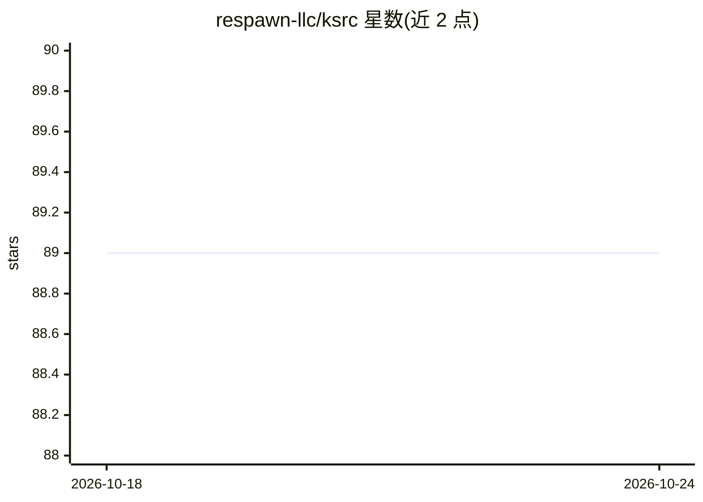

# respawn-llc/ksrc

⭐ 89 · Go · Apache-2.0 · 推送 2026-06-01 · [GitHub](https://github.com/respawn-llc/ksrc) · 组织维护

**让 AI 代理高效搜索阅读 Gradle 第三方依赖源码的 CLI**

面向在 Gradle/Kotlin 项目中工作的 AI 代理的命令行工具：提供 search/cat/where/deps 等命令，代理可用两条命令定位并读取第三方依赖的源码（函数签名、实现），替代手工下载、解包 source jar 再 ripgrep 的多步流程，降低 token 消耗。支持 KMP 目标过滤、artifact/module 限定、GRADLE_USER_HOME 覆盖；以 Homebrew 或独立二进制安装，另提供 Claude Code 插件、Codex skill 与 MCP stdio server 三种接入方式。

## 筛选速览

| 维度 | 判定 | 备注 |
|---|---|---|
| AI 角色 | `ai-ecosystem` | LLM/agent 周边工具 |
| 许可风险 | `permissive` | Apache-2.0 |
| 部署形态 | `None` |  |
| 模型依赖 | — | README 未给出锁定关系 |
| 硬件要求 | — | 无带数字的原话,不猜 |
| 安装摩擦 | `low` | 无编译、无系统依赖或容器化 |
| 成熟度 | — | 结构信号不足 |

## 能力要点

- search/cat/where/deps 等 CLI 命令直接检索依赖源码内容
- 支持 Claude Code 插件、Codex skill 与 MCP stdio server 接入
- 支持 KMP targets、--artifact/--module 限定与 GRADLE_USER_HOME 覆盖
- 持久化 file-id 对应的 jar 路径，后续读取免重复传参

## 适用场景

- 让 AI 代理快速查看第三方 Kotlin 库的 API 签名与实现
- 在 Gradle 项目中替代代理手工下载解包 source jar 的流程
- 为无 bash 工具的代理通过 MCP 提供依赖源码检索能力

## 场景标签

 · 领域:开发工具/AI 代理基础设施

## 证据(README 行号)

> L3: **One‑liner search and read for Gradle 3rd-party dependency sources for AI agents.**
> L9: It's a CLI utility to enable efficient dependency source search for AI agents working with Gradle projects.
> L39: Next up, install the claude code plugin/skill, to let your agents know they _can_ use `ksrc` and how to use it.

## 星数曲线

2026-10-18 89 → 2026-10-24 89（+0）

---
*卡片 v1 · prompt 1.4 · 生成 2026-10-23 · 置信度 high · 依据 README sha `bb44fdd7a620` · [字段定义](../../DATASET.md)*
