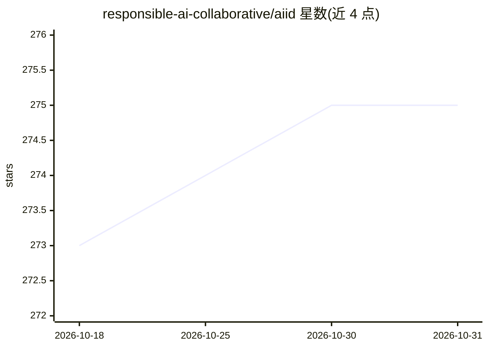

# responsible-ai-collaborative/aiid

⭐ 275 · JavaScript · NOASSERTION · 推送 2026-10-28 · [GitHub](https://github.com/responsible-ai-collaborative/aiid) · [官网](https://incidentdatabase.ai) · 组织维护

**AI 事件数据库：收录、定义并编目人工智能相关事件**

由 Responsible AI Collaborative 维护的开源项目，目标是识别、定义并编目人工智能引发的负面事件（AI incidents）。数据库以 MongoDB 存储，通过 Gatsby 静态站点与只读 GraphQL 端点对外提供数据访问，搜索由 Algolia 索引，内容管理使用 Prismic CMS。README 面向贡献者，说明贡献流程（事件摘要、分类法、代码变更、新应用）与工程流程。GraphQL 端点要求登录账户，网页浏览则无需登录；分类法细节见 arXiv 论文。

## 筛选速览

| 维度 | 判定 | 备注 |
|---|---|---|
| AI 角色 | `ai-knowledge` | 知识聚合/清单类 |
| 许可风险 | `none` | NOASSERTION |
| 部署形态 | `None` |  |
| 模型依赖 | — | README 未给出锁定关系 |
| 硬件要求 | — | 无带数字的原话,不猜 |
| 安装摩擦 | `low` | 无编译、无系统依赖或容器化 |
| 成熟度 | — | 结构信号不足 |

## 能力要点

- 编目 AI 事件并支持程序化生成的数据库摘要（summary）
- 提供只读 GraphQL 端点（/api/graphql），需登录账户访问
- 站点采用 Gatsby + Netlify + Algolia + MongoDB 的无服务器架构
- 支持贡献新分类法（taxonomy），详见 arXiv 论文

## 适用场景

- 查询历史上 AI 系统造成的负面事件以做研究或风险评估
- 通过 GraphQL 端点构建基于事件数据的应用
- 为数据库贡献事件摘要、分类法或代码

## 场景标签

`科研工具` `精选清单` · 领域:学习与行业

## 证据(README 行号)

> L8:  Artificial Intelligence Incident Database
> L20: Information about the goals and organization of the AI Incident Database can be found on the production website. Th
> L24: 3. Contribute a **new taxonomy** to the AI Incident Database. Details on taxonomies are available in the arXiv pape

## 星数曲线

2026-10-18 273 → 2026-10-31 275（+2）

---
*卡片 v1 · prompt 1.4 · 生成 2026-10-22 · 置信度 high · 依据 README sha `5580f19f24cb` · [字段定义](../../DATASET.md)*
