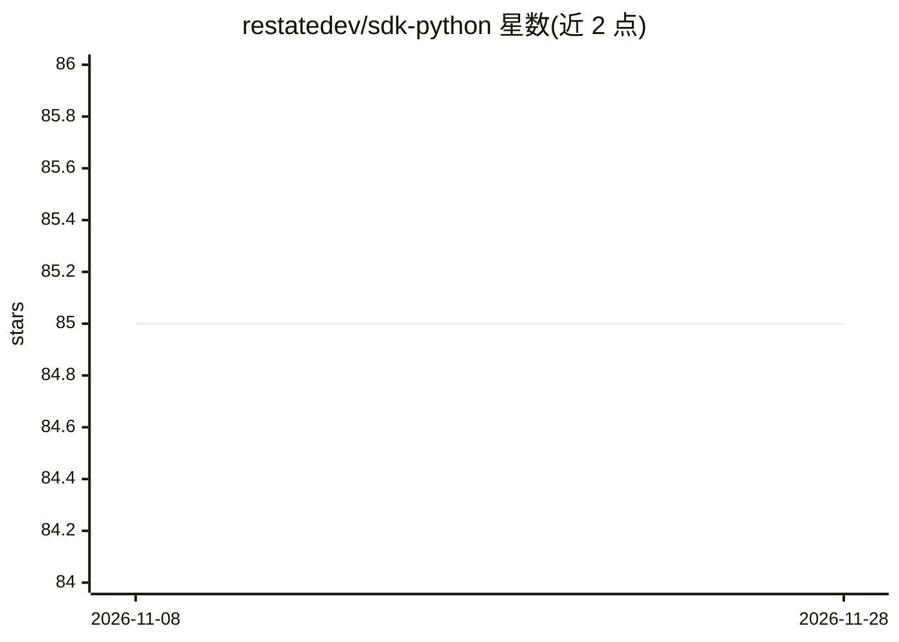

# restatedev/sdk-python

⭐ 85 · Python · MIT · 推送 2026-11-25 · [GitHub](https://github.com/restatedev/sdk-python) · 组织维护

**Python SDK：用 durable async/await 构建弹性分布式应用**

Restate 系统的官方 Python SDK，用于编写服务、虚拟对象、工作流、会话对象与 agent，通过 distributed durable async/await 机制构建弹性应用。SDK 以 pip 安装，可用内置 restate.serve 或任意 ASGI 服务器（如 Hypercorn）提供服务，也可通过连接密钥出站连接 Restate Cloud 免于暴露端口。要求 Python>=3.11；sdk-python 版本低于 0.10 已废弃。本地开发需 Rust 工具链与 maturin 构建。

## 筛选速览

| 维度 | 判定 | 备注 |
|---|---|---|
| AI 角色 | `ai-ecosystem` | LLM/agent 周边工具 |
| 许可风险 | `permissive` | MIT |
| 部署形态 | `library` | 以包/库形式分发 |
| 模型依赖 | — | README 未给出锁定关系 |
| 硬件要求 | — | 无带数字的原话,不猜 |
| 安装摩擦 | `low` | 无编译、无系统依赖或容器化 |
| 成熟度 | — | 结构信号不足 |

## 能力要点

- 支持服务/虚拟对象/工作流/会话对象/agent 的定义与注册
- restate.serve 或任意 ASGI 服务器部署，监听 $PORT 或 9080
- 可出站连接 Restate Cloud，无需暴露端口
- 本地开发经 maturin 构建 Rust 扩展模块

## 适用场景

- 用 Python 编写带持久化执行语义的分布式服务
- 将 agent 与工具作为 durable 服务部署到 Restate
- 通过 Restate Cloud 以出站连接方式部署应用

## 场景标签

`工作流自动化` · 领域:效率与自动化

## 证据(README 行号)

> L8: Restate is a system for easily building resilient applications using *distributed durable async/await*. This reposit
> L35: `restate.Servable`: session objects, and agents, each of which brings along its own companion

## 星数曲线

2026-11-08 85 → 2026-11-28 85（+0）

---
*卡片 v1 · prompt 1.4 · 生成 2026-11-18 · 置信度 high · 依据 README sha `aa5bb76cdaf6` · [字段定义](../../DATASET.md)*
