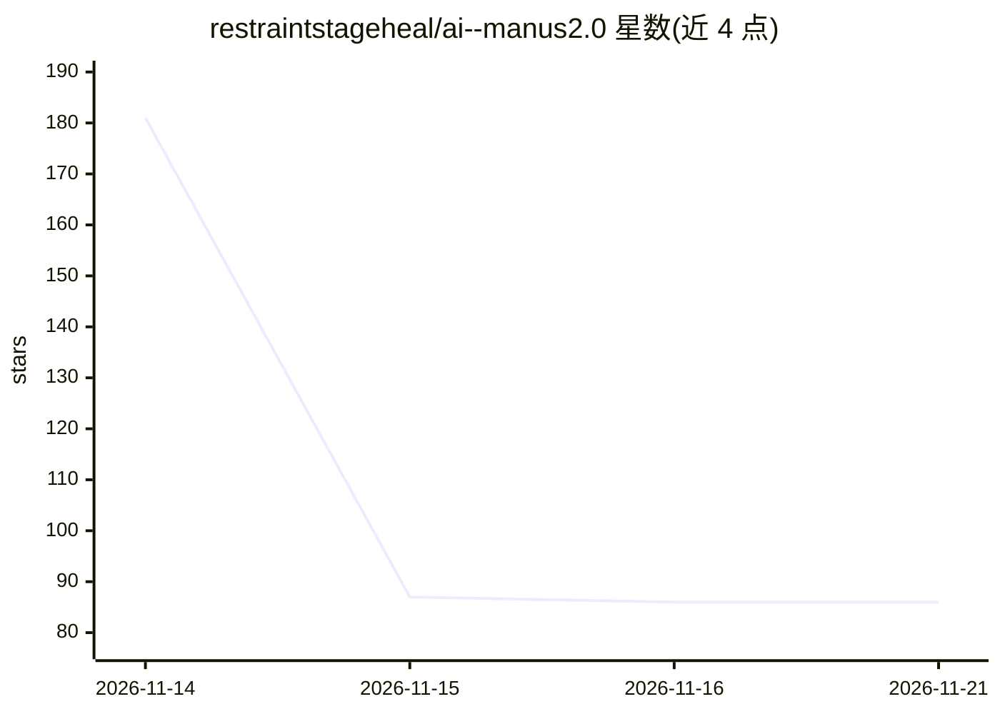

# restraintstageheal/ai--manus2.0

⭐ 86 · Apache-2.0 · 推送 2026-11-15 · [GitHub](https://github.com/restraintstageheal/ai--manus2.0) · 个人维护

**面向个人用户的自主 AI Agent：代跑代码并操控浏览器**

Manus 是一个自主 AI Agent 系统，在沙箱环境中运行各类工具与操作：自主编写并执行脚本、控制浏览器（导航网页、填表、采集信息），完成多步骤任务，可跨会话复用工作流模式。定位为家庭、学习与轻量办公场景的个人助手，面向无开发背景的用户，非企业级平台。README 提供硬件兼容表（最低双核 CPU、4 GB 内存）与上手步骤说明，但未给出具体安装命令、依赖或源码构建方式，实际获取途径仅有‘Download Manus’与一个优惠码，技术实现细节缺失。

## 筛选速览

| 维度 | 判定 | 备注 |
|---|---|---|
| AI 角色 | `ai-native` | 本体是模型或模型工具 |
| 许可风险 | `permissive` | Apache-2.0 |
| 部署形态 | `None` |  |
| 模型依赖 | — | README 未给出锁定关系 |
| 硬件要求 | — | 无带数字的原话,不猜 |
| 安装摩擦 | `low` | 无编译、无系统依赖或容器化 |
| 成熟度 | — | 结构信号不足 |

## 能力要点

- 自主执行代码与控制浏览器，完成多步骤任务
- 代码与浏览器操作可在同一工作流中衔接
- 面向非开发者的个人助手定位，支持后台运行

## 适用场景

- 让代理代替我跑脚本和打开网页采集信息
- 整理研究笔记、填写重复表单等日常琐事
- 小型项目中把重复步骤交给后台代理处理

## 场景标签

`AI 助手` `浏览器自动化` `编码 Agent` · 领域:效率与自动化

## 证据(README 行号)

> L10: - **Autonomous Code Execution:** Manus AI agent runs code on its own to complete tasks, so you can focus on decisio
> L18: Manus is an autonomous AI agent designed to run code and control a browser on your behalf. Instead of acting like a

## 星数曲线

2026-11-14 181 → 2026-11-21 86（-95）

---
*卡片 v1 · prompt 1.4 · 生成 2026-11-17 · 置信度 mid · 依据 README sha `637da4fbcded` · [字段定义](../../DATASET.md)*
