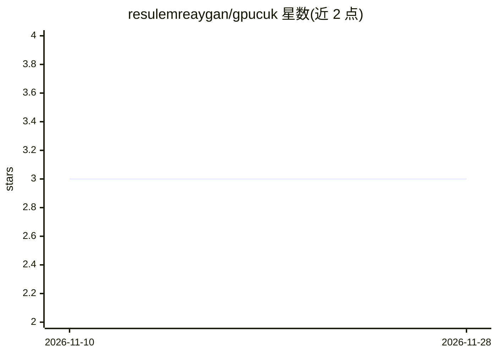

# resulemreaygan/gpucuk

⭐ 3 · C · MIT · 推送 2026-11-01 · [GitHub](https://github.com/resulemreaygan/gpucuk) · 个人维护

**在电子阅读器芯片上本地运行 142K 参数微型语言模型**

一个 hobby 项目：在 XTEINK X3 电子阅读器的 ESP32-C3（RISC-V 单核 160 MHz、无 FPU、400 KB RAM）上从零训练并离线运行 141,696 参数的 Transformer 语言模型，从 9 个预置问题生成回答并流式写入 e-ink 屏幕（约 3.8–4.0 token/秒），无网络与手机参与；摇晃设备换随机 seed，Back 键切换温度。README 声明模型不理解语义，答案多为模板组合。提供主机端 C 编译运行路径，固件基于 PlatformIO 构建并刷写，支持恢复出厂固件。

## 筛选速览

| 维度 | 判定 | 备注 |
|---|---|---|
| AI 角色 | `ai-native` | 本体是模型或模型工具 |
| 许可风险 | `permissive` | MIT |
| 部署形态 | `library` | 以包/库形式分发 |
| 模型依赖 | — | README 未给出锁定关系 |
| 硬件要求 | — | 无带数字的原话,不猜 |
| 安装摩擦 | `low` | 无编译、无系统依赖或容器化 |
| 成熟度 | — | 结构信号不足 |

## 能力要点

- 141,696 参数模型在 ESP32-C3 上全离线推理，权重 554 KB 直读 flash
- 主机端用任意 C 编译器复现设备输出（同 seed 同答案）
- MAC CPU 约 2 分钟完成训练，含记忆化实验与复现文档
- MIT 许可，推理代码结构沿用 llama2.c

## 适用场景

- 在无网络的嵌入式设备上端到端运行语言模型推理
- 研究极小参数量 Transformer 的训练与部署预算
- 在 XTEINK X3 上刷入自制固件并保留恢复途径

## 场景标签

`推理引擎` `模型训练` · 领域:训练与推理

## 证据(README 行号)

> L22: - A tiny language model that thinks it is a giant GPU, running entirely on the e-reader's own chip: an ESP32-C3 wit
> L24: - Pick one of 9 questions and press OK: the answer appears on the e-paper as the model writes it, at almost 4 chara
> L25: - No network and no phone. Every character of an answer comes out of the model, on the device.

## 星数曲线

2026-11-10 3 → 2026-11-28 3（+0）

---
*卡片 v1 · prompt 1.4 · 生成 2026-11-21 · 置信度 mid · 依据 README sha `68fa5c47fafc` · [字段定义](../../DATASET.md)*
