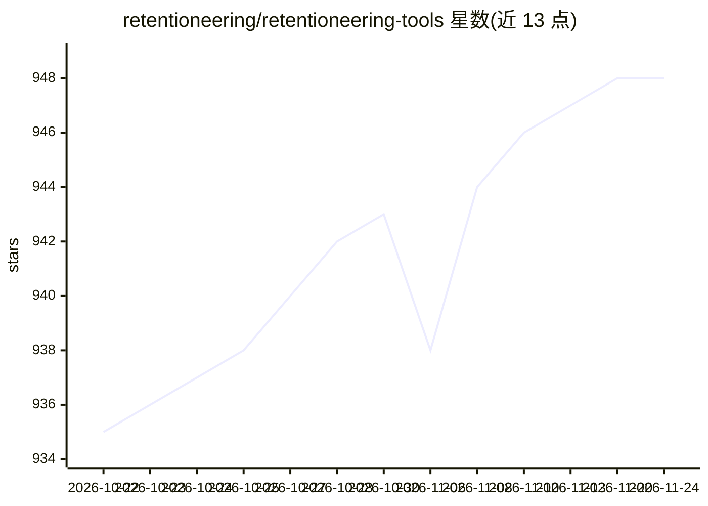

# retentioneering/retentioneering-tools

⭐ 948 · Python · Apache-2.0 · 推送 2026-11-22 · [GitHub](https://github.com/retentioneering/retentioneering-tools) · [官网](https://retentioneering.com/docs/) · 组织维护

**事件日志用户行为分析 Python 库，供数据科学家与 AI agent 使用**

从事件日志（user_id/event/timestamp 三列最小输入）分析用户行为序列：提供转移图、步矩阵、Step Sankey、漏斗、聚类分析等交互式 widget，支持路径过滤、分段比较、diff 模式与会话级分析；每个 widget 有返回数值的 headless 版本，并可导出为独立 HTML 页面。兼容 pandas 可读的数据源，附 GA4/Amplitude/Mixpanel/Segment 导出字段映射示例，内置合成电商数据集，另提供 MCP server 与 agent skills（见主题与描述）。要求 Python 3.11–3.13，可在 Jupyter、VS Code、Cursor、Colab 中运行。

## 筛选速览

| 维度 | 判定 | 备注 |
|---|---|---|
| AI 角色 | `ai-native` | 本体是模型或模型工具 |
| 许可风险 | `permissive` | Apache-2.0 |
| 部署形态 | `library` | 以包/库形式分发 |
| 模型依赖 | — | README 未给出锁定关系 |
| 硬件要求 | — | 无带数字的原话,不猜 |
| 安装摩擦 | `low` | 无编译、无系统依赖或容器化 |
| 成熟度 | — | 结构信号不足 |

## 能力要点

- 转移图/步矩阵/Sankey/漏斗/聚类等交互式分析 widget，支持 diff 模式比较两组行为
- 最小输入仅 user_id、event、timestamp 三列，任何 pandas 可读数据均可载入
- 每个 widget 配 headless 数据版本与 export_html 独立分享
- 内置合成电商数据集与 Colab demo，无需本地安装即可试用

## 适用场景

- 定位指标下降时用户路径的变化点
- 分析漏斗流失环节及流失用户的行为去向
- 对用户做行为聚类分群并作为分段比较
- 把 agent 运行的工具调用与错误序列当作路径分析循环与失败模式

## 场景标签

`数据分析` · 领域:效率与自动化

## 证据(README 行号)

> L3: Retentioneering is an open-source Python library for **understanding user behavior from event logs**. Find where use
> L141: ```python
> L246: A path doesn't have to be a user journey. Treat each agent run as a path and its internal steps – tool calls, retr

## 星数曲线



2026-10-22 935 → 2026-11-24 948（+13）


---
*卡片 v1 · prompt 1.4 · 生成 2026-11-24 · 置信度 high · 依据 README sha `097fec048020` · [字段定义](../../DATASET.md)*
