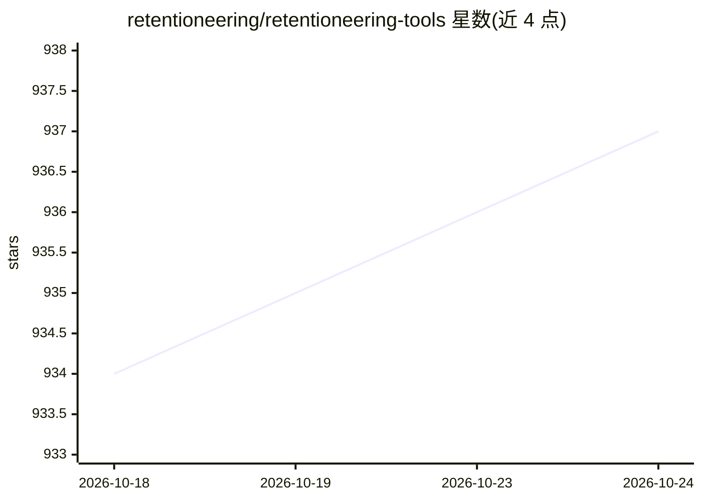

# retentioneering/retentioneering-tools

⭐ 937 · Python · Apache-2.0 · 推送 2026-10-23 · [GitHub](https://github.com/retentioneering/retentioneering-tools) · [官网](https://retentioneering.com/docs/) · 组织维护

**事件日志用户行为分析 Python 库，支持 AI agent 调用**

开源 Python 库（Apache 2.0），面向数据科学家、分析师与 AI agent，从事件流（点击流/会话日志）中分析用户行为路径。核心机制：Eventstream 类承载数据，数据处理器链式构建管道，交互式组件提供转移图、漏斗、Step Matrix、Step Sankey 与聚类分析；每个组件有 headless *_data() 版本返回底层数值，export_html() 可导出独立页面。支持聚类（轮廓系数选分区）与行为分段，可处理 GA4/Amplitude/Mixpanel/Segment 导出，也可将 agent 运行步骤作为事件序列分析。需 Python 3.10-3.13，配合 Jupyter/VS Code/Cursor/Colab 使用。

## 筛选速览

| 维度 | 判定 | 备注 |
|---|---|---|
| AI 角色 | `ai-native` | 本体是模型或模型工具 |
| 许可风险 | `permissive` | Apache-2.0 |
| 部署形态 | `library` | 以包/库形式分发 |
| 模型依赖 | — | README 未给出锁定关系 |
| 硬件要求 | — | 无带数字的原话,不猜 |
| 安装摩擦 | `low` | 无编译、无系统依赖或容器化 |
| 成熟度 | — | 结构信号不足 |

## 能力要点

- 转移图/漏斗/Step Matrix/Step Sankey 等交互式路径分析组件
- 基于路径指标的聚类分析与行为分段，可保存为 segment 复用
- 最小输入仅需 user_id、event、timestamp 三列，兼容 pandas 可读数据
- 可将 agent 运行（工具调用、重试、错误）作为事件序列分析成功/失败差异

## 适用场景

- 分析用户在漏斗中的流失位置及流失后的替代路径
- 对比不同分群（如实验组、移动/桌面）的行为路径差异
- 对用户或会话按行为模式聚类并保存为分段
- 分析 AI agent 运行日志，定位循环、报错与成功路径差异

## 场景标签

`数据分析` · 领域:效率与自动化

## 证据(README 行号)

> L3: Retentioneering is an open-source Python library for **understanding user behavior from event logs**. Find where use
> L142: stream.cluster_analysis()
> L246: A path doesn't have to be a user journey. Treat each agent run as a path and its internal steps – tool calls, retr

## 星数曲线

2026-10-18 934 → 2026-10-24 937（+3）

---
*卡片 v1 · prompt 1.4 · 生成 2026-10-21 · 置信度 mid · 依据 README sha `26466fe4c8c8` · [字段定义](../../DATASET.md)*
