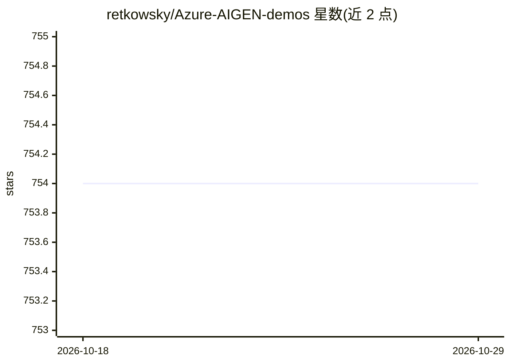

# retkowsky/Azure-AIGEN-demos

⭐ 754 · Jupyter Notebook · MIT · 推送 2026-10-27 · [GitHub](https://github.com/retkowsky/Azure-AIGEN-demos) · [官网](https://azure.microsoft.com/en-us/products/ai-foundry/) · 个人维护

**Microsoft Foundry 示例与加速器集合：面向 Azure AI 开发者**

围绕 Microsoft Foundry（Azure AI 平台服务）的演示、文档与加速器仓库，以 Jupyter notebook 形式按发布日期组织内容：覆盖 GPT 系列（gpt-5/gpt-5.2/gpt-4o）、gpt-image-1/2 图像生成与编辑、SORA 视频生成、Azure AI Agent Service（单/多智能体、文件搜索、代码解释器、Bing 集成）、AutoGen 多智能体系列、评测器（检索/风险安全/自定义）与追踪，以及 Mistral、Grok、Phi-4、Cohere 等第三方模型在 Foundry 上的用法。供在 Azure 上构建生成式 AI 应用的开发者参考使用。

## 筛选速览

| 维度 | 判定 | 备注 |
|---|---|---|
| AI 角色 | `ai-knowledge` | 知识聚合/清单类 |
| 许可风险 | `permissive` | MIT |
| 部署形态 | `None` |  |
| 模型依赖 | locked-api |  |
| 硬件要求 | — | 无带数字的原话,不猜 |
| 安装摩擦 | `low` | 无编译、无系统依赖或容器化 |
| 成熟度 | — | 结构信号不足 |

## 能力要点

- 按时间滚动发布，条目均为指向 notebook 的链接目录
- 覆盖 Azure AI Agent Service、AutoGen 多智能体与评测/追踪工作流
- 包含图像/视频生成（gpt-image 系列、SORA）与第三方模型（Mistral/Grok/Phi-4/Cohere）示例

## 适用场景

- 查找 Azure AI Foundry 上各模型的端到端用法示例
- 参考智能体编排、评测与追踪的实现模式
- 了解 Foundry 生态新增功能的快速上手示例

## 场景标签

`精选清单` `图像生成` `视频生成` `模型评测` · 领域:评测与运维

## 证据(README 行号)

> L3: Microsoft Foundry is a unified Azure platform-as-a-service offering for enterprise AI operations, model builders, an
> L14: | 🔥 Prompt Agent| Prompt Agent quickstart| https://github.com/retkowsky/Azure-AIGEN-demos/blob/main/Prompt%20Agent/

## 星数曲线

2026-10-18 754 → 2026-10-29 754（+0）

---
*卡片 v1 · prompt 1.4 · 生成 2026-10-22 · 置信度 high · 依据 README sha `b013c7b3a96a` · [字段定义](../../DATASET.md)*
