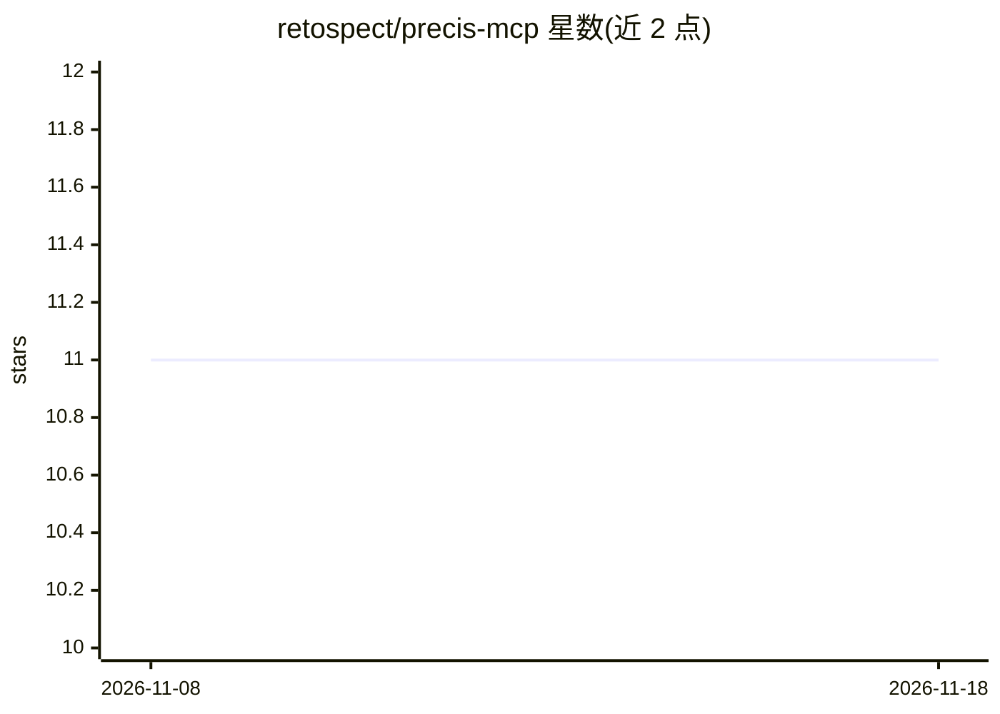

# retospect/precis-mcp

⭐ 11 · Python · GPL-3.0 · 推送 2026-11-17 · [GitHub](https://github.com/retospect/precis-mcp) · [官网](https://pypi.org/project/precis-mcp/) · 个人维护

**面向 LLM agent 的 MCP 服务器：读文献写论文并做模拟**

一个 Model Context Protocol 服务器，为语言模型 agent 提供统一的七动词（get/search/put/edit/delete/tag/link）工具面，覆盖文献阅读（段落级引用）、论文/专利/报告撰写与 LaTeX/PDF/Word 导出、原子结构与 CAD/PCB 建模、化学路线与材料属性，以及任务、记忆与审计。内容存于 PostgreSQL + pgvector，提供 Web 界面与音频旁白。通过 uv 或 pip 安装，核心确定性工具无需 API key，重型功能按 extras 可选启用。

## 筛选速览

| 维度 | 判定 | 备注 |
|---|---|---|
| AI 角色 | `ai-ecosystem` | LLM/agent 周边工具 |
| 许可风险 | `viral` | GPL-3.0 |
| 部署形态 | `library` | 以包/库形式分发 |
| 模型依赖 | — | README 未给出锁定关系 |
| 硬件要求 | — | 无带数字的原话,不猜 |
| 安装摩擦 | `medium` | 含编译或系统依赖之一 |
| 成熟度 | `idea` | |

## 能力要点

- 七动词统一工具面，单一 kind= 参数区分内容类别
- 声明与来源段落的绑定（citation→verified quote）与来源标注
- 支持论文、专利、CAD、PCB、化学/材料等跨领域内容类型
- 提供 extras 机制：缺依赖或 env var 的 kind 自动从工具面移除

## 适用场景

- 让 agent 阅读论文与专利并生成带段落级引用的综述或论文草稿
- 在研究流程中管理待办、任务树与长期记忆
- 用代码构建原子结构、CAD 装配与 PCB 设计并模拟

## 场景标签

`科研工具` `Agent 记忆` `AI 写作` · 领域:Agent 开发

## 证据(README 行号)

> L11: what it proposes. A Model Context Protocol
> L12: server for language-model agents:
> L24: Agents use seven verbs (`get`, `search`, `put`, `edit`, `delete`, `tag`,

## 星数曲线

2026-11-08 11 → 2026-11-18 11（+0）

---
*卡片 v1 · prompt 1.4 · 生成 2026-11-18 · 置信度 high · 依据 README sha `96fc1ecd48d4` · [字段定义](../../DATASET.md)*
