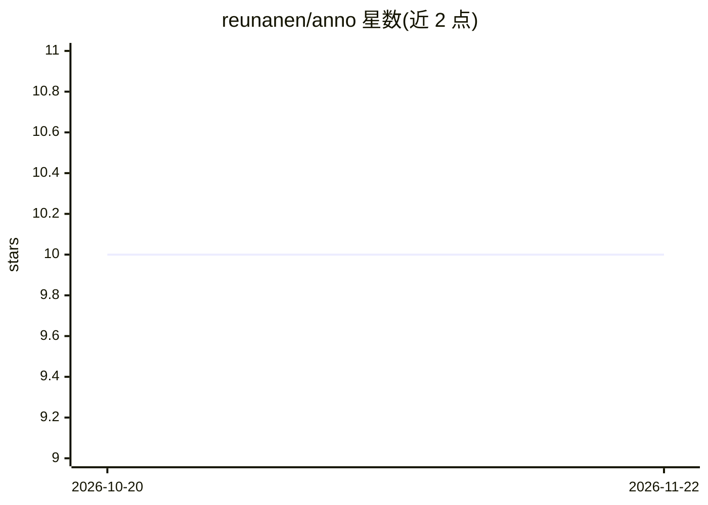

# reunanen/anno

⭐ 10 · C++ · MIT · 推送 2026-01-14 · [GitHub](https://github.com/reunanen/anno) · 个人维护

**为语义分割和目标检测标注图像的桌面应用**

anno 是一个桌面图像标注应用，用于为语义分割和目标检测任务生成标注数据。程序区分 "stuff mode"（stuff 类标注）与 "things mode"（things 类标注）两种模式，界面上分别提供对应截图示例。Windows 用户可在 GitHub Releases 页下载安装包使用。README 内容简短，除安装包来源与两种标注模式外未给出更多功能或依赖说明。

## 筛选速览

| 维度 | 判定 | 备注 |
|---|---|---|
| AI 角色 | `ai-enhanced` | 去掉 AI 部分产品仍成立 |
| 许可风险 | `permissive` | MIT |
| 部署形态 | `None` |  |
| 模型依赖 | — | README 未给出锁定关系 |
| 硬件要求 | — | 无带数字的原话,不猜 |
| 安装摩擦 | `low` | 无编译、无系统依赖或容器化 |
| 成熟度 | — | 结构信号不足 |

## 能力要点

- 支持语义分割与目标检测两类标注
- 提供 stuff / things 两种标注模式
- Releases 页提供 Windows 安装包

## 适用场景

- 为分割模型训练准备像素级标注数据
- 为检测模型标注图像中的目标框
- 本地桌面环境下离线标注图像数据集

## 场景标签

`目标检测` · 领域:感知与多模态

## 证据(README 行号)

> L3: A desktop application that can be used to annotate images for semantic segmentation and object detection purposes.
> L11: "Stuff mode" above. Below, the "things mode".

## 星数曲线

2026-10-20 10 → 2026-11-22 10（+0）

---
*卡片 v1 · prompt 1.4 · 生成 2026-11-19 · 置信度 high · 依据 README sha `fe385b05c6c1` · [字段定义](../../DATASET.md)*
