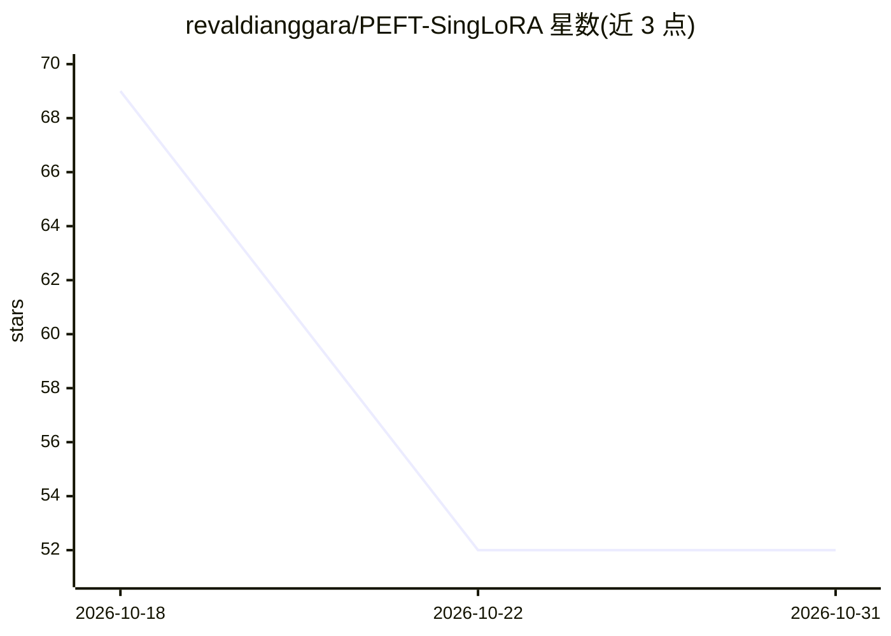

# revaldianggara/PEFT-SingLoRA

⭐ 52 · Python · BSD-2-Clause · 推送 2026-09-27 · [GitHub](https://github.com/revaldianggara/PEFT-SingLoRA) · 个人维护

**面向 PEFT 生态的单矩阵 LoRA 变体，适配器参数减半**

SingLoRA 的 PEFT 兼容 Python 实现：用单个低秩矩阵（W = W_0 + α/r * A @ A^T）替代标准 LoRA 的双矩阵分解，可训练参数从 2*d*r 降至 d*r。通过 setup_singlora() 注册到 Hugging Face PEFT 生态，get_peft_model 即可作用于目标线性层，另有手动模块映射方式。层为纯 PyTorch 实现，不依赖 flash-attn/triton；要求 Python 3.9+、PyTorch 1.13+（CUDA 或 CPU）、peft 0.7+、transformers 4.34+。提供示例目录与 pytest 测试套件，BSD 2-Clause 许可。

## 筛选速览

| 维度 | 判定 | 备注 |
|---|---|---|
| AI 角色 | `ai-ecosystem` | LLM/agent 周边工具 |
| 许可风险 | `permissive` | BSD-2-Clause |
| 部署形态 | `library` | 以包/库形式分发 |
| 模型依赖 | — | README 未给出锁定关系 |
| 硬件要求 | — | 无带数字的原话,不猜 |
| 安装摩擦 | `medium` | 含编译或系统依赖之一 |
| 成熟度 | — | 结构信号不足 |

## 能力要点

- 单矩阵分解使适配器参数较标准 LoRA 减半（d*r vs 2*d*r）
- 通过 setup_singlora() 以 drop-in 方式接入 PEFT 工作流
- 纯 PyTorch 实现，无 flash-attn/triton 依赖
- 支持自定义配置与手动模块映射（nn.Linear → SingLoRALinear）

## 适用场景

- 单 GPU 微调大模型时降低优化器状态占用
- 在既有 PEFT/transformers 工作流中替换标准 LoRA
- 参数受限场景下堆叠多个适配器

## 场景标签

`微调` · 领域:训练与推理

## 证据(README 行号)

> L9: SingLoRA (Single Low-Rank Adaptation) is an efficient alternative to traditional LoRA that uses a single low-rank ma
> L14: - 🔧 **Fully compatible with PEFT** ecosystem
> L30: from peft import LoraConfig, get_peft_model

## 星数曲线

2026-10-18 69 → 2026-10-31 52（-17）

---
*卡片 v1 · prompt 1.4 · 生成 2026-10-24 · 置信度 high · 依据 README sha `825e90c452d2` · [字段定义](../../DATASET.md)*
