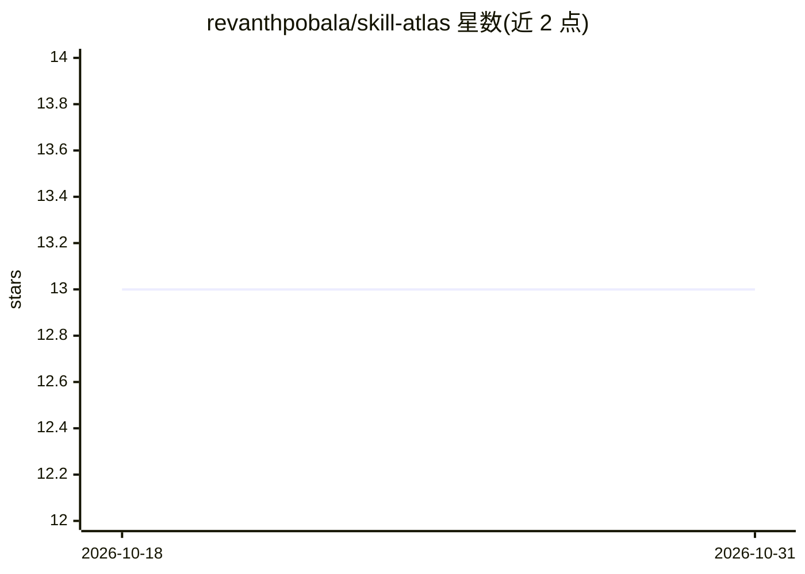

# revanthpobala/skill-atlas

⭐ 13 · TypeScript · 推送 2026-07-12 · [GitHub](https://github.com/revanthpobala/skill-atlas) · [官网](https://atlas-skills.vercel.app/) · 个人维护

**可视化编辑与校验 AI agent 技能指令图的无服务器工作台**

面向维护大量 markdown 技能文件的 AI agent 开发者的 IDE：解析整个技能仓库并自动构建可视化 DAG，展示显式依赖、隐式依赖与软引用；内置基于 Anthropic 技能指南的诊断引擎，检测超 token 限制、循环依赖、孤儿技能与缺失 frontmatter。支持浏览器内编辑技能、GitHub OAuth 直发 Pull Request、Monaco Diff 查看与 Jupyter Notebook 解析。BYOK 模式下可配置 OpenAI/Anthropic/Gemini 密钥驱动 AI Copilot 聊天分析。另提供 npx 无头 CLI 供 CI/CD 校验。

## 筛选速览

| 维度 | 判定 | 备注 |
|---|---|---|
| AI 角色 | `ai-ecosystem` | LLM/agent 周边工具 |
| 许可风险 | `none` | — |
| 部署形态 | `library` | 以包/库形式分发 |
| 模型依赖 | — | README 未给出锁定关系 |
| 硬件要求 | — | 无带数字的原话,不猜 |
| 安装摩擦 | `low` | 无编译、无系统依赖或容器化 |
| 成熟度 | — | 结构信号不足 |

## 能力要点

- 解析技能仓库自动构建可视化 DAG（显式/隐式依赖与软引用）
- 按 Anthropic 技能指南执行诊断：token 上限、循环依赖、孤儿检测、frontmatter 校验
- 浏览器内编辑技能并经 GitHub OAuth 直接提交 Pull Request
- npx agentic-skill-validator 无头 CLI 可集成 GitHub Actions

## 适用场景

- 在图形界面中梳理与编辑 agent 技能间的依赖关系
- 在 CI 中自动拦截违反 token 上限或结构规范的技能 PR
- 通过 BYOK 的 AI Copilot 对技能做重构分析

## 场景标签

`提示工程` · 领域:Agent 开发

## 证据(README 行号)

> L18: **Skill Atlas** is a standalone, serverless IDE designed specifically to solve this problem. It parses your entire 
> L83: Skill Atlas includes a headless CLI designed specifically for CI/CD pipelines. This allows teams to instantly valid

## 星数曲线

2026-10-18 13 → 2026-10-31 13（+0）

---
*卡片 v1 · prompt 1.4 · 生成 2026-10-31 · 置信度 high · 依据 README sha `c2ab991d95c9` · [字段定义](../../DATASET.md)*
