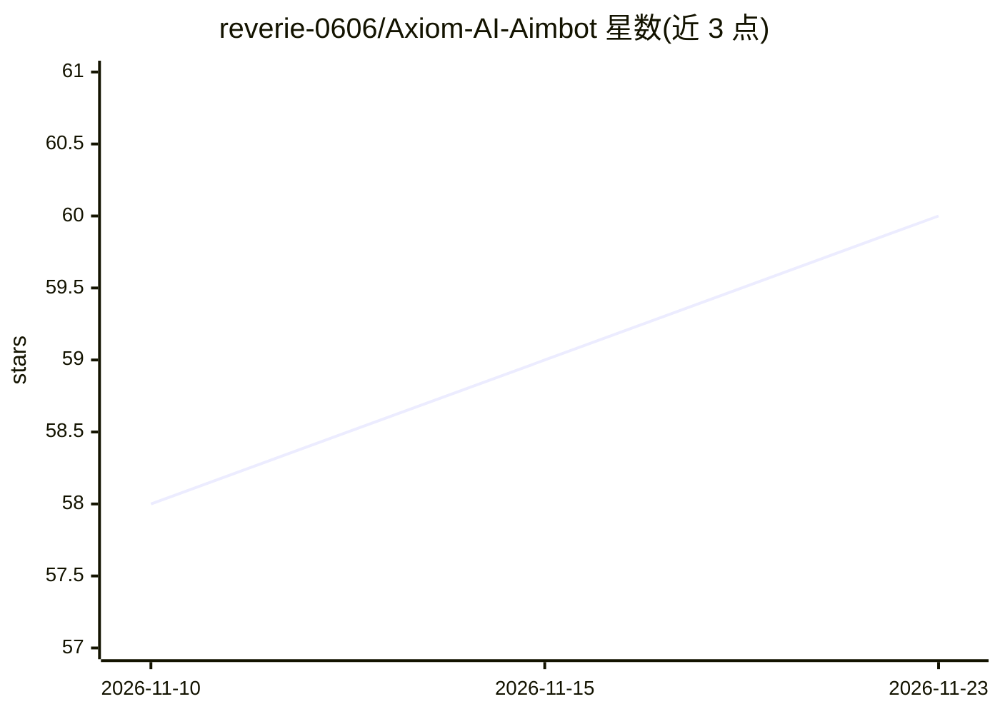

# reverie-0606/Axiom-AI-Aimbot

⭐ 60 · Python · NOASSERTION · 推送 2026-05-01 · [GitHub](https://github.com/reverie-0606/Axiom-AI-Aimbot) · 个人维护 · 中文 README

**Windows 计算机视觉自瞄工具：检测目标并自动控制鼠标**

面向 Windows 10/11 的实时计算机视觉桌面应用：截屏、ONNX 检测模型推理、叠加层渲染与可配置输入自动化。提供 PID/贝塞尔曲线瞄准控制、追踪预测、自动开火、dxcam/mss 截屏后端、DirectML/CUDA/TensorRT/ROCm 计算后端选择，以及从鼠标事件到 Arduino HID、虚拟 Xbox 手柄等多种输入方式。 PyQt6 界面支持 10 种语言。 README 附免责声明：使用可能违反游戏或平台规则。采用 PolyForm Noncommercial 非商业许可。

## 筛选速览

| 维度 | 判定 | 备注 |
|---|---|---|
| AI 角色 | `ai-native` | 本体是模型或模型工具 |
| 许可风险 | `none` | NOASSERTION |
| 部署形态 | `desktop` | 安装包/桌面程序 |
| 模型依赖 | — | README 未给出锁定关系 |
| 硬件要求 | — | 无带数字的原话,不猜 |
| 安装摩擦 | `medium` | 含编译或系统依赖之一 |
| 成熟度 | — | 结构信号不足 |

## 能力要点

- 从 GitLab 模型目录下载或自行添加 .onnx 检测模型
- ONNX Runtime 后端可选 DirectML/CUDA/TensorRT/ROCm，CPU 不自动回退
- 7 种输入后端（mouse_event/sendinput/ddxoft/Arduino HID/MAKCU/虚拟手柄等）
- Setup Wizard 可安装匹配的 ONNX Runtime wheel 并保存命名预设

## 适用场景

- 在 Windows 游戏中做基于视觉的目标检测与输入自动化
- 调整 FOV、置信度、PID 与追踪参数进行瞄准控制
- 通过叠加层查看检测框与状态面板

## 场景标签

`目标检测` · 领域:感知与多模态

## 证据(README 行号)

> L20: Axiom AI is a real-time computer-vision desktop application for screen capture, object detection, overlay rendering
> L48:  - ONNX Runtime backend selection for DirectML, CUDA, TensorRT, and ROCm.

## 星数曲线

2026-11-10 58 → 2026-11-23 60（+2）

---
*卡片 v1 · prompt 1.4 · 生成 2026-11-18 · 置信度 high · 依据 README sha `2ba3207cc9de` · [字段定义](../../DATASET.md)*
