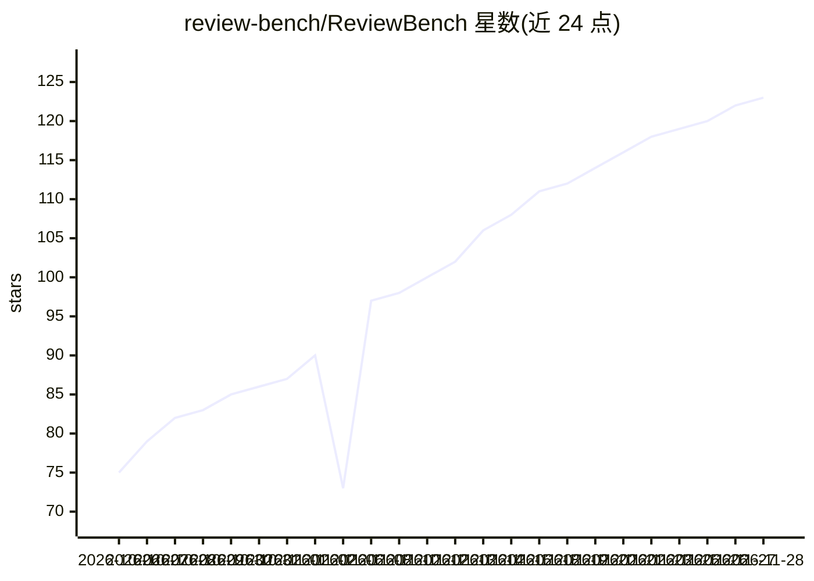

# review-bench/ReviewBench

⭐ 123 · TypeScript · MIT · 推送 2026-11-23 · [GitHub](https://github.com/review-bench/ReviewBench) · [官网](https://review-bench.ai) · 组织维护

**评测 AI 代码审查系统的可复现基准（25+219 个真实 PR）**

GitHub 开发的开源基准，用于在真实 pull request 上评测 AI 代码审查系统。每个 PR 配有人工审核的 golden findings 作为 ground truth，通过比对 agent 产出与参考集衡量其识别有效问题并避免误报的能力，结果可按严重度与类别维度查看。仓库包含 25 任务测试集、219 任务全集、仓库镜像、标注分类器脚本、本地判定 CLI 与公开 Harbor 基准；上榜需经自助门户提交，本地结果仅用于开发调优。

## 筛选速览

| 维度 | 判定 | 备注 |
|---|---|---|
| AI 角色 | `ai-ecosystem` | LLM/agent 周边工具 |
| 许可风险 | `permissive` | MIT |
| 部署形态 | `None` |  |
| 模型依赖 | — | README 未给出锁定关系 |
| 硬件要求 | — | 无带数字的原话,不猜 |
| 安装摩擦 | `low` | 无编译、无系统依赖或容器化 |
| 成熟度 | — | 结构信号不足 |

## 能力要点

- 25 个测试集任务与 219 个全集任务，覆盖多语言与变更规模
- 人工审核的 golden findings 作为 ground truth（共 2,565 条）
- 源仓库镜像保证基准在原仓库被删/改写后仍可运行
- 本地离线评测 CLI 支持自选 LLM judge

## 适用场景

- 上线前在标准 PR 集上离线评测自家代码审查 agent
- 通过自助门户将审查器提交到公开排行榜
- 用公开 judge prompt 在本地对全集打分调优

## 场景标签

`代码审查` `模型评测` · 领域:编码与开发

## 证据(README 行号)

> L4: ReviewBench, developed by GitHub, is an open, reproducible benchmark for evaluating AI code review systems on real-w
> L34:  Privately score findings for tuning with an LLM judge you choose.
> L157: runs and locally generated metrics are for development only and cannot be

## 星数曲线

2026-10-26 75 → 2026-11-28 123（+48）

---
*卡片 v1 · prompt 1.4 · 生成 2026-11-28 · 置信度 high · 依据 README sha `7eca21c56a10` · [字段定义](../../DATASET.md)*
