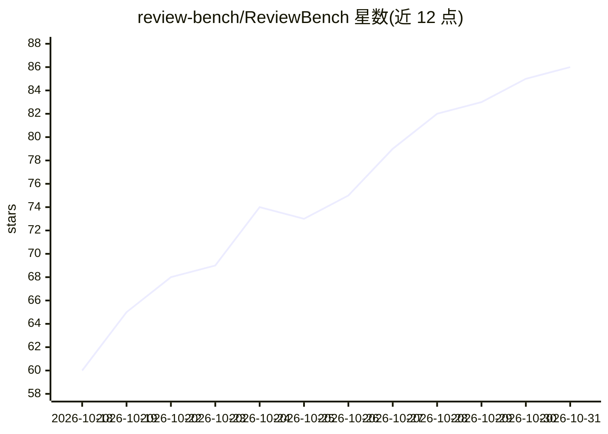

# review-bench/ReviewBench

⭐ 86 · TypeScript · MIT · 推送 2026-10-29 · [GitHub](https://github.com/review-bench/ReviewBench) · [官网](https://review-bench.ai) · 组织维护

**评测 AI 代码审查系统的开放基准（219 个真实 PR 与金标发现）**

由 GitHub 开发的可复现基准：基于真实 pull request 构建语料（测试集 25 个 PR、全集 219 个 PR），每个 PR 附带人工复核的金标审查发现作为 ground truth，用于度量审查 agent 识别有效问题并避免误报的可靠性。提供评审 agent 接入契约、Codex CLI 示例、本地测试脚本、本地评分 CLI 与自服务门户排行榜流程；本地结果仅用于调优，不能作为排行榜成绩发布。

## 筛选速览

| 维度 | 判定 | 备注 |
|---|---|---|
| AI 角色 | `ai-knowledge` | 知识聚合/清单类 |
| 许可风险 | `permissive` | MIT |
| 部署形态 | `None` |  |
| 模型依赖 | — | README 未给出锁定关系 |
| 硬件要求 | — | 无带数字的原话,不猜 |
| 安装摩擦 | `low` | 无编译、无系统依赖或容器化 |
| 成熟度 | — | 结构信号不足 |

## 能力要点

- 219 个 PR 语料与全部金标发现公开，源仓库提供镜像
- 提供 agent 契约、Codex CLI 示例与 try-agent.sh 本地测试脚本
- 可自带 LLM judge 用自有凭证对 219 个 PR 私有评分调优
- 通过自服务门户接入，官方最终评测三輪跑全集并发布排行榜

## 适用场景

- 评估我的 AI 代码审查 agent 在真实 PR 上的表现
- 上线前在本地对审查 agent 做调优与私有评分
- 查看代码审查基准语料与金标发现的构成

## 场景标签

`模型评测` · 领域:评测与运维

## 证据(README 行号)

> L4: ReviewBench, developed by GitHub, is an open, reproducible benchmark for evaluating AI code review systems on real-w
> L6: For each pull request, the benchmark provides a human-reviewed golden set of code review findings that serves as the
> L133: You can benchmark any reviewer on your own machine without registering or

## 星数曲线

2026-10-18 60 → 2026-10-31 86（+26）

---
*卡片 v1 · prompt 1.4 · 生成 2026-10-24 · 置信度 high · 依据 README sha `0024ab54b15e` · [字段定义](../../DATASET.md)*
