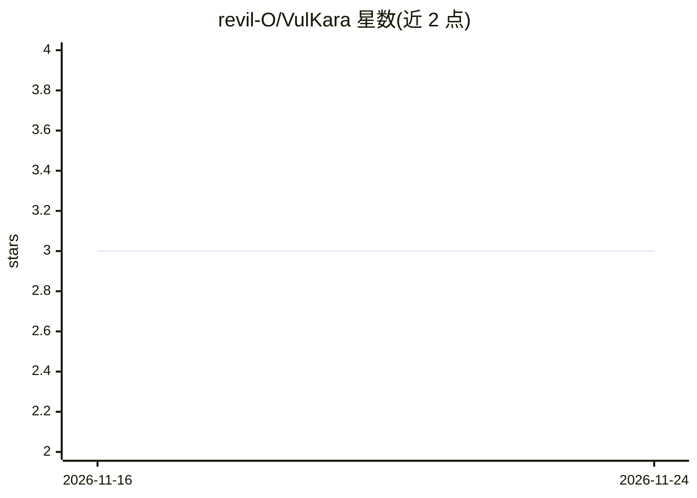

# revil-O/VulKara

⭐ 3 · Python · NOASSERTION · 推送 2026-11-14 · [GitHub](https://github.com/revil-O/VulKara) · [官网](https://www.vulkara.net) · 个人维护

**Apple 芯片 Mac 本地 AI 图像生成器：文生图/修复/训练全离线**

面向 Apple silicon Mac 的本地 AI 图像生成桌面应用（Electron/Vue/TypeScript），功能覆盖文生图、图生图、笔刷 inpainting、无限画布 outpainting、图生视频、放大、老照片修复、ControlNet、LoRA 管理与训练。核心机制是 SSD 流式推理：超出内存的模型按块从内置或外置 SSD 读取，使需要 24 GB 的模型在 16 GB Mac 上以 16-bit 精度运行。内置 Diffusers（PyTorch on Metal）、MLX 两个引擎，可选 ComfyUI，由应用自动安装并按模型选择。图片与提示词不离开本机，网络仅用于下载运行时、模型与更新。

## 筛选速览

| 维度 | 判定 | 备注 |
|---|---|---|
| AI 角色 | `ai-native` | 本体是模型或模型工具 |
| 许可风险 | `none` | NOASSERTION |
| 部署形态 | `library` | 以包/库形式分发 |
| 模型依赖 | — | README 未给出锁定关系 |
| 硬件要求 | — | 无带数字的原话,不猜 |
| 安装摩擦 | `low` | 无编译、无系统依赖或容器化 |
| 成熟度 | — | 结构信号不足 |

## 能力要点

- SSD 流式推理让 24 GB 级模型在 16 GB Mac 上运行，保留 16-bit 精度
- Diffusers/MLX 双引擎（可选 ComfyUI），应用自动安装并按模型自动选择
- 支持 SD 1.5/2.x/SDXL/SD 3.5/FLUX 系列/Qwen-Image/Wan 2.2 等多模型及 GGUF 流式
- 提示词检查、未成年人保护、AI 元数据标记等内建安全机制

## 适用场景

- 在 Mac 上完全离线地生成和编辑图片
- 恢复和修复老照片（划痕、上色、面部重建）
- 用自己的图片训练 LoRA 并在 Civitai/Hugging Face 查找匹配 LoRA
- 通过手机或局域网内其他设备的浏览器远程使用本机生成

## 场景标签

`图像生成` `图像视频处理` `视频生成` `微调` · 领域:内容生成

## 证据(README 行号)

> L5: **Your local AI image generator with high privacy**
> L64: Pictures, videos, photo restoration and LoRA training run on the Apple GPU. Prompts and pictures never leave the Ma
> L74: **Diffusers** (PyTorch on Metal), **MLX** (fast for FLUX, the only one for Krea 2, Ideogram 4 and FLUX 3) and, opti

## 星数曲线

2026-11-16 3 → 2026-11-24 3（+0）

---
*卡片 v1 · prompt 1.4 · 生成 2026-11-22 · 置信度 mid · 依据 README sha `362f3009fc19` · [字段定义](../../DATASET.md)*
