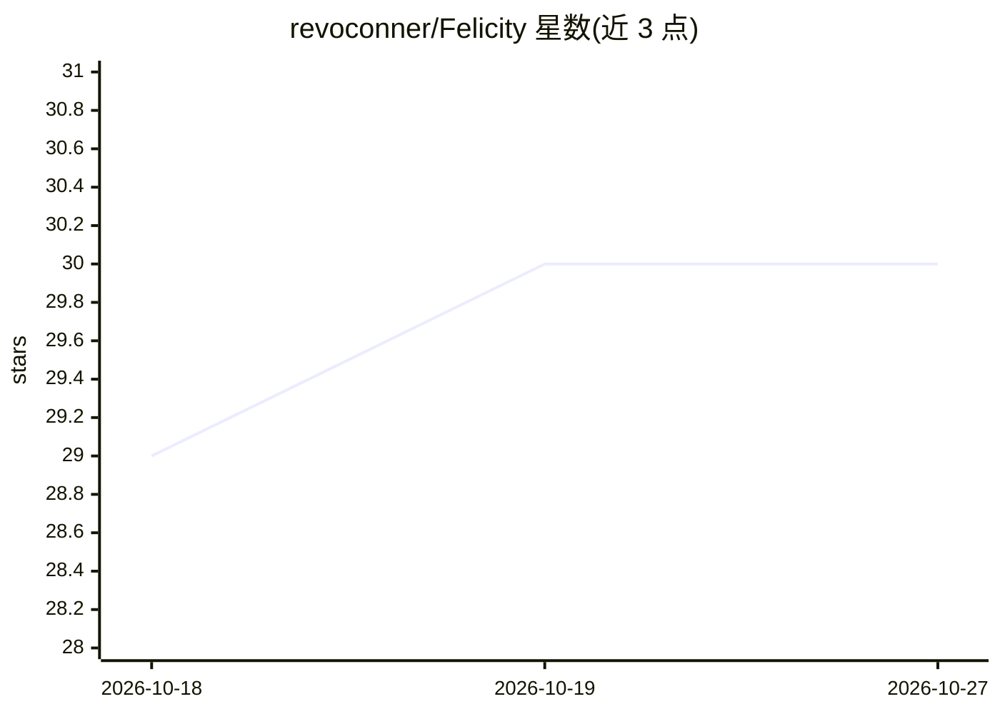

# revoconner/Felicity

⭐ 30 · 推送 2026-08-07 · [GitHub](https://github.com/revoconner/Felicity) · [官网](https://felicity-app.com) · 个人维护

**Windows 离线人脸识别照片整理工具：按人物自动分组照片**

面向 Windows 普通用户的桌面照片整理应用：扫描本地文件夹，通过人脸识别将同一人的照片自动分组，无需手动标记。完全离线运行，无遥测、广告或订阅。内置色盲/对比度/阅读障碍等无障碍支持，提供导出整理结果（硬链接/复制）、XMP 标签导出（兼容 Lightroom）等进阶功能。源码不在仓库内托管（防 fork 换皮），通过带机器人防火墙的外部链接提供查看，许可证为 source-available，允许个人和商业使用但禁止商业化再分发。

## 筛选速览

| 维度 | 判定 | 备注 |
|---|---|---|
| AI 角色 | `ai-native` | 本体是模型或模型工具 |
| 许可风险 | `none` | — |
| 部署形态 | `None` |  |
| 模型依赖 | — | README 未给出锁定关系 |
| 硬件要求 | — | 无带数字的原话,不猜 |
| 安装摩擦 | `low` | 无编译、无系统依赖或容器化 |
| 成熟度 | — | 结构信号不足 |

## 能力要点

- 人脸识别自动按人物分组整个照片库，无需手动确认
- 完全离线运行，无遥测、广告与订阅
- 导出 XMP 标签兼容 Lightroom，支持硬链接/复制导出整理结果
- 色盲（4 类）、对比度、阅读障碍字体等无障碍支持

## 适用场景

- 整理本地照片库并按人物自动分组
- 将人脸分组结果以 XMP 导出到 Lightroom 工作流
- 隐私敏感场景下离线管理照片

## 场景标签

`人脸识别` · 领域:感知与多模态

## 证据(README 行号)

> L7: Felicity is the offline, privacy focused and ease of use focused, facial recognition photo organizer for Windows. It
> L11: A no-nonsense photo organiser for windows, if you want to group people by faces without having to deal with complex

## 星数曲线

2026-10-18 29 → 2026-10-27 30（+1）

---
*卡片 v1 · prompt 1.4 · 生成 2026-10-26 · 置信度 high · 依据 README sha `77ed493ccb54` · [字段定义](../../DATASET.md)*
