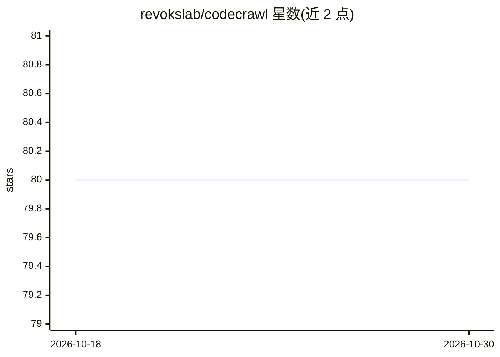

# revokslab/codecrawl

⭐ 80 · TypeScript · AGPL-3.0 · 推送 2026-01-25 · [GitHub](https://github.com/revokslab/codecrawl) · [官网](https://crawl.revoks.dev) · 组织维护

**把代码仓库转成 LLM 可用数据的 API 服务**

输入仓库 URL，抓取 GitHub/Gitlab 公开代码库并转换为 markdown/XML/纯文本等格式，生成嵌入存入向量库，提供文件树、语义搜索、llms.txt 生成、结构化数据提取与批量处理等 API 端点。任务以异步 job 形式执行，返回 job ID 查询状态。目前仅支持公开代码库；提供托管版本（需注册获取 API key）与后端自托管两种方式，SDK 现有 Node 版。

## 筛选速览

| 维度 | 判定 | 备注 |
|---|---|---|
| AI 角色 | `ai-ecosystem` | LLM/agent 周边工具 |
| 许可风险 | `viral` | AGPL-3.0 |
| 部署形态 | `None` |  |
| 模型依赖 | — | README 未给出锁定关系 |
| 硬件要求 | — | 无带数字的原话,不猜 |
| 安装摩擦 | `low` | 无编译、无系统依赖或容器化 |
| 成熟度 | — | 结构信号不足 |

## 能力要点

- 抓取代码库并转换为 markdown/XML/纯文本多格式输出
- 生成嵌入存入向量库，支持语义搜索
- 生成面向 LLM 的 llms.txt（异步 job + 状态查询）
- 文件树、结构化数据提取与多仓库批量处理

## 适用场景

- 为 LLM 应用准备干净的代码库数据
- 为 RAG 系统构建代码库检索数据源
- 为模型生成仓库的 llms.txt 概览文件

## 场景标签

`RAG` `语义搜索` `网页抓取` · 领域:效率与自动化

## 证据(README 行号)

> L13: Codecrawl is an API service that takes a repository URL, crawls it, and converts it into clean markdown or structur
> L9: Empower your AI apps with clean data from any repository. Featuring advanced codebase file-trees, semantic search, l

## 星数曲线

2026-10-18 80 → 2026-10-30 80（+0）

---
*卡片 v1 · prompt 1.4 · 生成 2026-10-24 · 置信度 high · 依据 README sha `2338ae87478a` · [字段定义](../../DATASET.md)*
