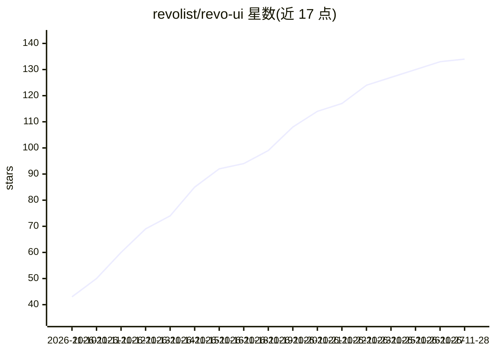

# revolist/revo-ui

⭐ 134 · TypeScript · MIT · 推送 2026-11-27 · [GitHub](https://github.com/revolist/revo-ui) · [官网](https://ui.rv-grid.com) · 组织维护

**跨框架数据应用 UI 组件库：含 AI 聊天、图表等组件**

面向数据分析看板与业务应用的组件库，零运行时依赖、支持 tree-shaking，压缩后组件加样式约 15.4 KiB gzip。提供按钮、表单、多选、时间线、日历、图表、分页、AI 助手聊天组件与 PDF 查看器等，通过适配层接入 React、Vue、Angular、Svelte、Preact 及原生 TypeScript，各框架适配器自动加载组件样式，并提供主题 token、JSON/CSS 预设定制、SSR 指南与 CDN 免构建使用方式。MIT 许可。

## 筛选速览

| 维度 | 判定 | 备注 |
|---|---|---|
| AI 角色 | `ai-enhanced` | 去掉 AI 部分产品仍成立 |
| 许可风险 | `permissive` | MIT |
| 部署形态 | `library` | 以包/库形式分发 |
| 模型依赖 | — | README 未给出锁定关系 |
| 硬件要求 | — | 无带数字的原话,不猜 |
| 安装摩擦 | `low` | 无编译、无系统依赖或容器化 |
| 成熟度 | — | 结构信号不足 |

## 能力要点

- 支持 React/Vue/Angular/Svelte/Preact/vanilla TS 的同一组件库
- AI 助手组件：聊天消息、提示、建议与任务状态
- 0 运行时依赖，组件+样式 15.4 KiB gzip，可 tree-shake
- 主题 token 与 JSON/CSS 命名预设，跨项目共享

## 适用场景

- 为数据分析看板搭一套跨框架统一 UI
- 在业务应用中嵌入 AI 聊天界面与 PDF 查看器
- 按设计系统定制组件预设并多项目复用

## 场景标签

 · 领域:前端开发/UI 组件库

## 证据(README 行号)

> L16: **Build data-rich applications with charts, AI chat, a PDF viewer, editable timelines, date controls, and more.**
> L102: - AI assistant — Chat messages, prompts, suggestions, and task states.
> L67: |React|Named components from `@revolist/ui/react`, with React state, children, and callbacks.|

## 星数曲线

2026-11-10 43 → 2026-11-28 134（+91）

---
*卡片 v1 · prompt 1.4 · 生成 2026-11-28 · 置信度 high · 依据 README sha `8b56bb79ade7` · [字段定义](../../DATASET.md)*
