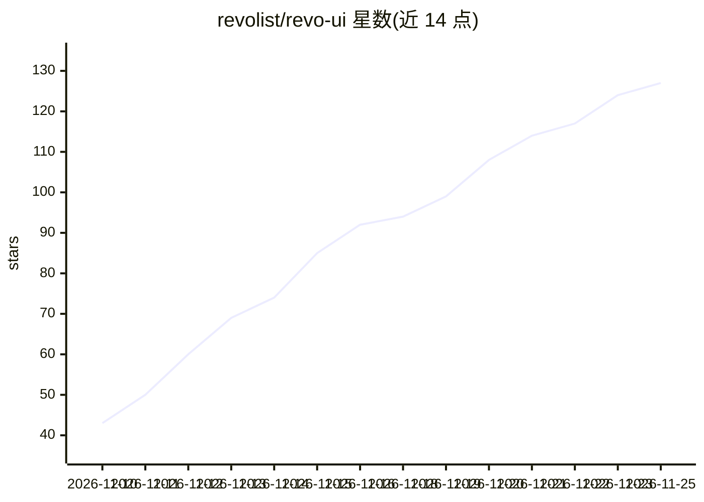

# revolist/revo-ui

⭐ 127 · TypeScript · MIT · 推送 2026-11-23 · [GitHub](https://github.com/revolist/revo-ui) · [官网](https://ui.rv-grid.com) · 组织维护

**多框架 UI 组件库，面向数据密集型应用与仪表盘**

面向 React、Vue、Angular、Svelte、Preact 与原生 TypeScript 的轻量组件库，用于构建分析仪表盘与业务应用。提供日期/时间选择器、图表、多选/下拉、PDF 查看器、可编辑时间轴与 AI 助手聊天等组件，MIT 许可，0 运行时依赖，组件加样式约 15.4 KiB gzip，支持 tree-shaking 与按需细粒度导入。AI 部分为聊天/提示/任务状态组件，属于组件能力之一，库本身不依赖 AI 仍可用。通过 npm 安装，也可从源码构建。

## 筛选速览

| 维度 | 判定 | 备注 |
|---|---|---|
| AI 角色 | `ai-enhanced` | 去掉 AI 部分产品仍成立 |
| 许可风险 | `permissive` | MIT |
| 部署形态 | `library` | 以包/库形式分发 |
| 模型依赖 | — | README 未给出锁定关系 |
| 硬件要求 | — | 无带数字的原话,不猜 |
| 安装摩擦 | `low` | 无编译、无系统依赖或容器化 |
| 成熟度 | — | 结构信号不足 |

## 能力要点

- 单一库覆盖 React/Vue/Angular/Svelte/Preact/原生 TS 六种集成
- 0 运行时依赖、tree-shakeable ESM、组件+样式 15.4 KiB gzip
- 含 AI 助手聊天组件与 PDF 查看器、可编辑时间轴等数据密集场景组件
- 框架无关的日期工具集（@revolist/ui/dates）

## 适用场景

- 构建跨框架复用同一套组件的业务应用
- 组装带图表、日期选择与 PDF 查看的分析仪表盘
- 为应用添加 AI 聊天助手界面组件

## 场景标签

 · 领域:前端 UI 组件/数据应用

## 证据(README 行号)

> L16: **Build data-rich applications with charts, AI chat, a PDF viewer, editable timelines, date controls, and more.**
> L94: - AI assistant — Chat messages, prompts, suggestions, and task states.

## 星数曲线

2026-11-10 43 → 2026-11-25 127（+84）

---
*卡片 v1 · prompt 1.4 · 生成 2026-11-17 · 置信度 high · 依据 README sha `6ced462efd57` · [字段定义](../../DATASET.md)*
