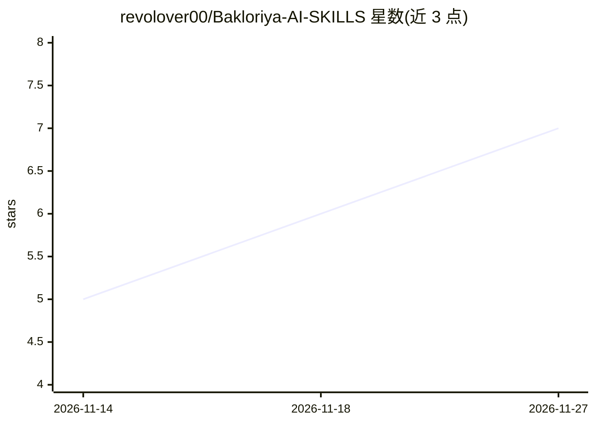

# revolover00/Bakloriya-AI-SKILLS

⭐ 7 · MIT · 推送 2026-11-20 · [GitHub](https://github.com/revolover00/Bakloriya-AI-SKILLS) · 个人维护

**面向埃及 Bakloriya 课程体系的 AI 教师技能库**

将 2026/2027 学年埃及四个学段（埃及高中体系、普通高中、初中、小学）各年级、两学期的全部课程转换为结构化 AI 技能文件，按 阶段/年级/学期/科目 目录组织；每科目含 README、SKILL.md、术语表、题型模式、速查表及独立章节文件，共 300 个已完成模块。使用者将仓库的 AGENTS.md 原始链接粘贴到任何 AI 中，由 AI 读取指引后讲解课程、分步解题并生成三级难度测试题。

## 筛选速览

| 维度 | 判定 | 备注 |
|---|---|---|
| AI 角色 | `ai-knowledge` | 知识聚合/清单类 |
| 许可风险 | `none` | MIT |
| 部署形态 | `None` |  |
| 模型依赖 | — | README 未给出锁定关系 |
| 硬件要求 | — | 无带数字的原话,不猜 |
| 安装摩擦 | `low` | 无编译、无系统依赖或容器化 |
| 成熟度 | — | 结构信号不足 |

## 能力要点

- 覆盖四个学段、300 个模块、按 阶段/年级/学期/科目 分层组织
- 每科目提供 SKILL.md、术语表、题型模式与考前速查表
- 通过 AGENTS.md 原始链接一键供 AI 读取并自动导航任意课程内容
- 题目分三级难度并解释正确答案与干扰项错误原因

## 适用场景

- 让 AI 按埃及最新课程逐章讲解某一科目
- 生成某一章节的分级练习题并获取答案解析
- 考前速查某一科目的术语与题型套路

## 场景标签

`教程课程` · 领域:学习与行业

## 证据(README 行号)

> L1: # Bakloriya-AI-SKILLS — منصة المعلم الذكي للمناهج المصرية
> L31: لا تحتاج إلى نسخ روابط كثيرة. يكفي الرابط النصي المباشر (Raw URL) لدليل التوجيه الرئيسي `AGENTS.md`، وسيتولى الذكاء
> L55: رابط دليل التوجيه الرئيسي (مطابق في `AGENTS.md` و `CLAUDE.md`):

## 星数曲线

2026-11-14 5 → 2026-11-27 7（+2）

---
*卡片 v1 · prompt 1.4 · 生成 2026-11-20 · 置信度 high · 依据 README sha `8871680a86ca` · [字段定义](../../DATASET.md)*
