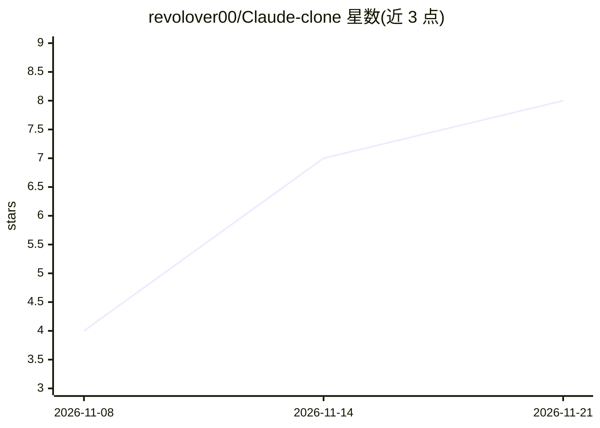

# revolover00/Claude-clone

⭐ 8 · TypeScript · MIT · 推送 2026-11-20 · [GitHub](https://github.com/revolover00/Claude-clone) · [官网](https://claude-clone.ai.studio/) · 个人维护 · 中文 README

**开发者自托管的多模型 BYOK 聊天界面，复刻 Claude.ai 体验**

以 React 19 + Vite 前端与 Express 5 网关构建的聊天应用，通过 SSE 流式转发对话请求；内置 15 个 provider 与 668 个模型的目录快照，服务器不保存任何 AI key，每次调用使用用户在 Settings → Providers 中自行填入并加密存储的 API key。功能包含消息版本分叉、交互式 artifacts 预览、项目知识库、Google 搜索 grounding、个人记忆与 skills。本地 npm run dev 以访客会话直接启动，生产部署依赖 Supabase 会话。

## 筛选速览

| 维度 | 判定 | 备注 |
|---|---|---|
| AI 角色 | `ai-native` | 本体是模型或模型工具 |
| 许可风险 | `none` | MIT |
| 部署形态 | `library` | 以包/库形式分发 |
| 模型依赖 | locked-api |  |
| 硬件要求 | — | 无带数字的原话,不猜 |
| 安装摩擦 | `low` | 无编译、无系统依赖或容器化 |
| 成熟度 | — | 结构信号不足 |

## 能力要点

- 15 provider / 668 模型目录随仓库捆绑，可由 catalog:sync 刷新
- BYOK 架构：服务器零 AI 密钥，用户 key 在设置中加密存储
- 消息版本分支、artifacts 实时预览、项目知识库与搜索 grounding
- /assistant 页面复用同一 SSE 管线的 assistant-ui 线程

## 适用场景

- 用自己的各 provider API key 自托管一个多模型聊天界面
- 在单一界面切换对比不同厂商的模型
- 需要消息分支与 artifacts 预览的对话工作流

## 场景标签

`聊天机器人` `AI 助手` · 领域:对话与助手

## 证据(README 行号)

> L3: A high-fidelity clone of the Claude.ai chat experience — built with **React 19**, **TypeScript**, **Tailwind CSS 4**
> L5: - **15 providers · 668 models** bundled out of the box (OpenAI, Gemini, Groq, OpenRouter, Cerebras, DeepSeek, xAI, M
> L6: - **Bring your own key** — the server ships with **zero AI secrets**; every call runs on the API key each user saves

## 星数曲线

2026-11-08 4 → 2026-11-21 8（+4）

---
*卡片 v1 · prompt 1.4 · 生成 2026-11-20 · 置信度 high · 依据 README sha `b07bf0460f24` · [字段定义](../../DATASET.md)*
