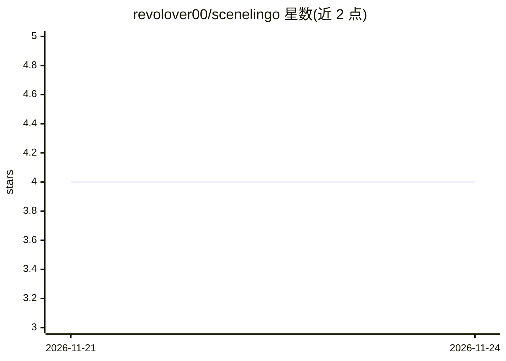

# revolover00/scenelingo

⭐ 4 · Python · NOASSERTION · 推送 2026-11-22 · [GitHub](https://github.com/revolover00/scenelingo) · [官网](https://t.me/SceneLingoo_bot) · 个人维护

**面向语言学习者的 Telegram 机器人：按 CEFR 等级推送电影片段学语言**

订阅者在 Telegram 内完成引导式设置：选择界面语言、学习语言、CEFR 等级（A2–C2）、解释语言与推送间隔，机器人随后定时推送配短电影片段的表达条目。内容由 Groq API（qwen3.8-27b 与 Whisper）生成解释并做音频校验，片段来自 Clip.Cafe。调度由 cron-job.org 触发 GitHub Actions 执行，数据存 Neon Postgres；支持 Vercel webhook 或本地轮询运行，含可靠投递（槽位认领、不确定发送标记）与只读管理面板。作者标注多语言推送为实验性，免费额度限制可能延迟或阻止发送。

## 筛选速览

| 维度 | 判定 | 备注 |
|---|---|---|
| AI 角色 | `ai-native` | 本体是模型或模型工具 |
| 许可风险 | `none` | NOASSERTION |
| 部署形态 | `library` | 以包/库形式分发 |
| 模型依赖 | locked-api |  |
| 硬件要求 | — | 无带数字的原话,不猜 |
| 安装摩擦 | `medium` | 含编译或系统依赖之一 |
| 成熟度 | — | 结构信号不足 |

## 能力要点

- CEFR A2–C2 等级选择，10 种语言菜单（学习/解释语言）
- Groq API 生成表达与解释，Whisper 做音频校验后才发送片段
- cron-job.org + GitHub Actions 的免费无服务器调度方案
- 可靠投递机制：唯一槽位认领、不确定发送标记、限速重试上限

## 适用场景

- 在 Telegram 里按自己的等级定时接收带电影片段的语言表达
- 为不同语言/等级的学习群组自动推送教学内容
- 自托管一个零服务器运维的语言学习推送机器人

## 场景标签

 · 领域:教育/语言学习

## 证据(README 行号)

> L8: A Telegram bot for useful expressions with matching short movie clips and explanations. Subscribers choose a CEFR le
> L34: |Groq API (`qwen/qwen3.8-27b`, Whisper)|Expressions, explanations and audio verification|

## 星数曲线

2026-11-21 4 → 2026-11-24 4（+0）

---
*卡片 v1 · prompt 1.4 · 生成 2026-11-21 · 置信度 mid · 依据 README sha `6d8411d21350` · [字段定义](../../DATASET.md)*
