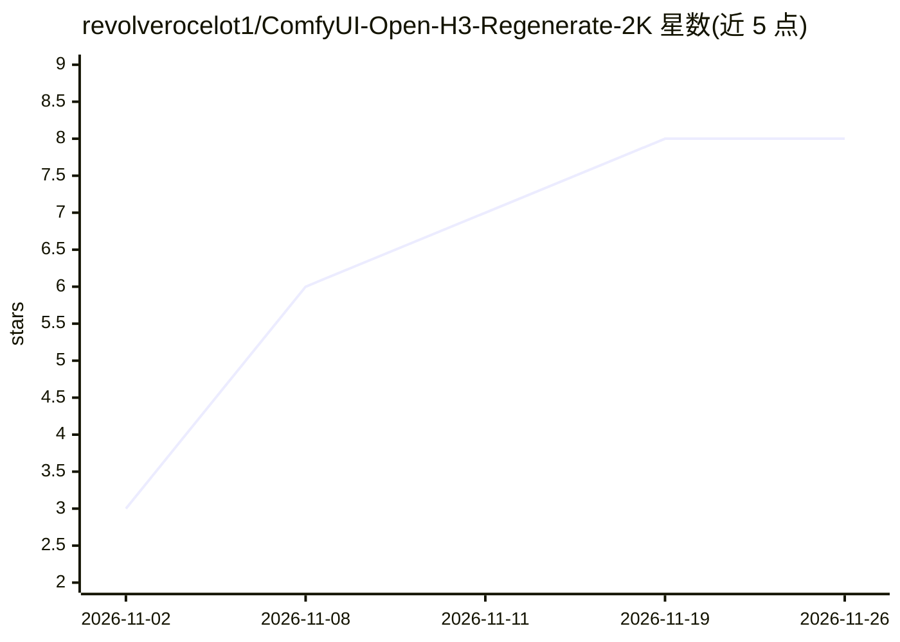

# revolverocelot1/ComfyUI-Open-H3-Regenerate-2K

⭐ 8 · Python · 推送 2026-11-17 · [GitHub](https://github.com/revolverocelot1/ComfyUI-Open-H3-Regenerate-2K) · 个人维护

**ComfyUI 两阶段视频精修工作流：768p 草稿经人工审批后升到 2K**

提供 MiniMax-H3 的 ComfyUI 原生工作流集合，覆盖 R2V/I2V/T2V 三种模态。核心是两阶段流程：Stage 1 生成可播放的 768p 草稿并保存，随后经过交互式审批门暂停执行，由用户在界面按钮上选择 2x/2K、4x/4K 放大或仅保留草稿；批准后进入 Stage 2 的 3 步 In-Context 精修，使用官方 3D-Conv 潜空间上采样器与 3 个 LoRA 组合，输出 2560×1440 或 4K @24fps 带音频视频。安装方式为克隆到 ComfyUI/custom_nodes 并用脚本下载模型。

## 筛选速览

| 维度 | 判定 | 备注 |
|---|---|---|
| AI 角色 | `ai-native` | 本体是模型或模型工具 |
| 许可风险 | `none` | — |
| 部署形态 | `None` |  |
| 模型依赖 | — | README 未给出锁定关系 |
| 硬件要求 | — | 无带数字的原话,不猜 |
| 安装摩擦 | `low` | 无编译、无系统依赖或容器化 |
| 成熟度 | — | 结构信号不足 |

## 能力要点

- R2V/I2V/T2V 三种模态的即用型两阶段 ComfyUI 工作流
- 交互式审批门：执行无计时器暂停，按钮选择放大倍率或停止
- 3 步 In-Context 精修：官方 3D-Conv 潜空间上采样器 + 3 个 LoRA 叠加
- 附交互式对比页面（浏览器内 8x 放大镜对比草稿与成品）

## 适用场景

- 先用 768p 草稿预览视频效果，确认后再花算力升到 2K
- 在 ComfyUI 中用 MiniMax-H3 生成 2K/4K 分辨率的视频
- 对比放大前后细节以决定是否精修

## 场景标签

`视频生成` · 领域:内容生成

## 证据(README 行号)

> L3: Native ComfyUI implementation of the upgraded **In-Context (`Open-H3-Regenerate-2K-IC`)** video refinement pipeline 
> L18: The `workflows/` directory contains ready-to-run two-stage ComfyUI graphs:

## 星数曲线

2026-11-02 3 → 2026-11-26 8（+5）

---
*卡片 v1 · prompt 1.4 · 生成 2026-11-20 · 置信度 high · 依据 README sha `bde432f6ca53` · [字段定义](../../DATASET.md)*
