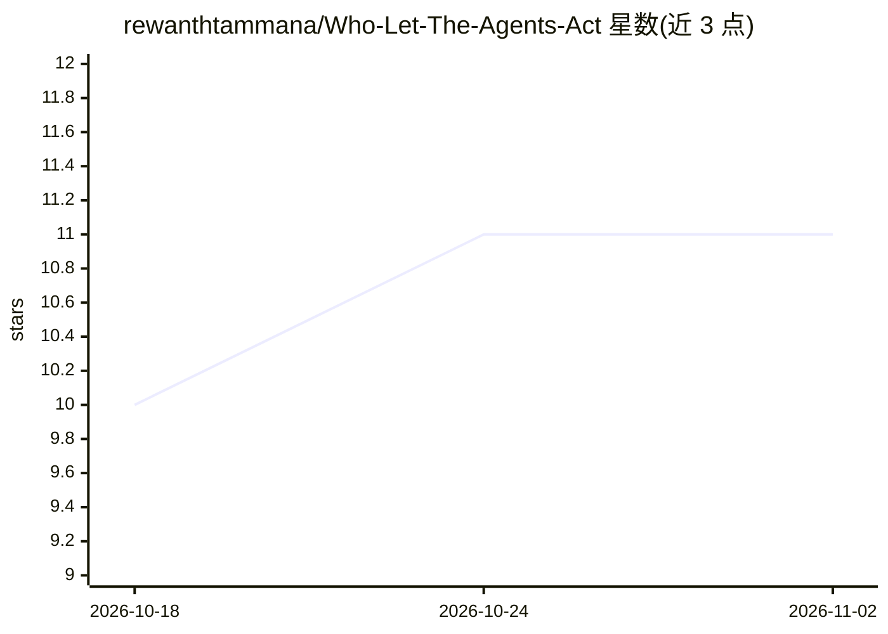

# rewanthtammana/Who-Let-The-Agents-Act

⭐ 11 · Python · Apache-2.0 · 推送 2026-09-25 · [GitHub](https://github.com/rewanthtammana/Who-Let-The-Agents-Act) · [官网](https://rewanthtammana.com/who-let-the-agents-act/) · 个人维护

**AI Agent 安全力学实验室：对比脆弱/提示词/加固三种模式**

面向安全工程师与 Agent 开发者的交互式教学实验室：让已认证的 Agent 尝试越权访问他人数据，在 Vulnerable、Prompt-only、Hardened 三种模式下运行同一请求，对比模型控制与应用侧授权、最小权限、数据投影、输出 DLP 的差异。含 9 个自包含场景（IDOR、间接提示注入、多租户 RAG 泄露等），每次运行记录模型计划、策略决策、工具调用与结果为 JSON 证据。模型侧依赖 Groq API key，提供 pip 源码运行与 Docker 两种方式，数据全部为合成数据，明确警告勿接入生产环境。

## 筛选速览

| 维度 | 判定 | 备注 |
|---|---|---|
| AI 角色 | `ai-ecosystem` | LLM/agent 周边工具 |
| 许可风险 | `permissive` | Apache-2.0 |
| 部署形态 | `self-host` | docker 或自建部署 |
| 模型依赖 | — | README 未给出锁定关系 |
| 硬件要求 | — | 无带数字的原话,不猜 |
| 安装摩擦 | `low` | 无编译、无系统依赖或容器化 |
| 成熟度 | — | 结构信号不足 |

## 能力要点

- 同一请求在脆弱/提示词/加固三种模式下的对比运行
- 9 个自包含安全场景，各带数据库、种子数据与策略
- 运行痕迹以 JSON 记录，UI 展示决策与证据链
- 提供静态检查、单元测试与 Groq 矩阵验证脚本

## 适用场景

- 学习为什么系统提示词不是授权边界
- 测试 Agent 应用的越权与提示注入风险
- 对比应用侧授权与提示词防护的实际效果

## 场景标签

`网络安全` `教程课程` · 领域:学习与行业

## 证据(README 行号)

> L26: |Mode|What happens|Security boundary|
> L32: The model can propose an intent, identifier, field, or action. Application code validates the proposal and enforces

## 星数曲线

2026-10-18 10 → 2026-11-02 11（+1）

---
*卡片 v1 · prompt 1.4 · 生成 2026-11-01 · 置信度 high · 依据 README sha `9b87eb84e319` · [字段定义](../../DATASET.md)*
