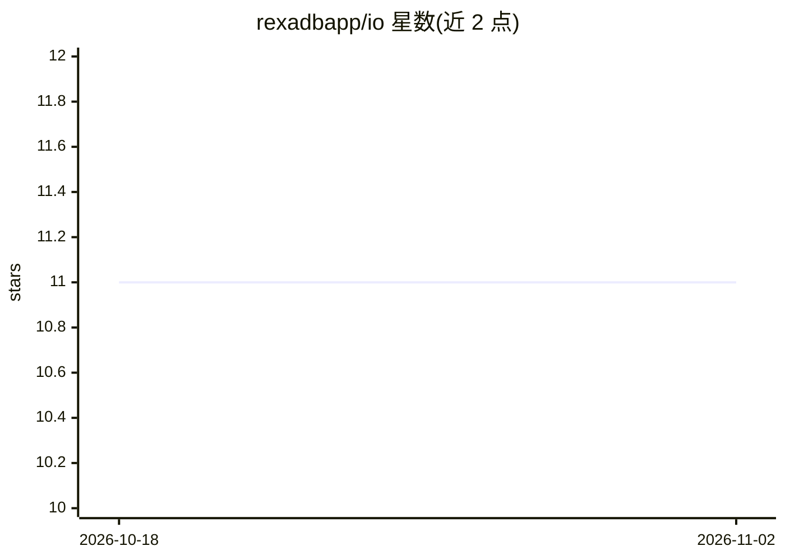

# rexadbapp/io

⭐ 11 · Zig · MIT · 推送 2026-08-27 · [GitHub](https://github.com/rexadbapp/io) · 个人维护

**单文件终端 LLM 编码 agent，约 1MB 二进制、180+ 供应商**

用 Zig 编写的终端编码 agent，以单二进制分发，宣称约 1MB 体积、除 libc 外无外部运行时依赖。通过 OpenAI 兼容接口连接 180+ 供应商（OpenAI、Anthropic、Google、Groq、DeepSeek、OpenRouter 等，经 models.dev 注册表，另含本地 Ollama）。支持流式对话、工具调用（读写/编辑文件、grep、glob、bash、网页搜索/抓取）、会话持久化与上下文窗口临近时的自动压缩。提供 curl 一键安装脚本、各平台二进制与 Zig 0.16.0+ 源码构建，覆盖 macOS/Linux/Windows 的 x86_64 与 ARM64。

## 筛选速览

| 维度 | 判定 | 备注 |
|---|---|---|
| AI 角色 | `ai-native` | 本体是模型或模型工具 |
| 许可风险 | `permissive` | MIT |
| 部署形态 | `None` |  |
| 模型依赖 | local-ok | 支持本地模型 |
| 硬件要求 | — | 无带数字的原话,不猜 |
| 安装摩擦 | `low` | 无编译、无系统依赖或容器化 |
| 成熟度 | — | 结构信号不足 |

## 能力要点

- 单二进制分发，Linux 静态编译，无外部运行时依赖
- 180+ 供应商接入，含本地 Ollama
- 工具调用：文件读写/编辑、grep、glob、bash、网页搜索/抓取
- 上下文临近上限时自动摘要压缩，会话自动保存可恢复

## 适用场景

- 在终端里让 LLM agent 读写代码文件并执行命令
- 切换使用不同云供应商或本地 Ollama 模型
- 低成本部署一个无需运行时依赖的编码助手

## 场景标签

`编码 Agent` · 领域:编码与开发

## 证据(README 行号)

> L3: A tiny, self-contained LLM coding agent. One binary, 180+ providers, zero runtime dependencies.
> L5: `io` is a single-file-distributed terminal agent that talks to any OpenAI-compatible LLM provider. It supports strea
> L10: - **Tool use** — read/write/edit files, list directories, grep, glob, bash execution, web search, web fetch.

## 星数曲线

2026-10-18 11 → 2026-11-02 11（+0）

---
*卡片 v1 · prompt 1.4 · 生成 2026-11-01 · 置信度 high · 依据 README sha `02758c64e493` · [字段定义](../../DATASET.md)*
