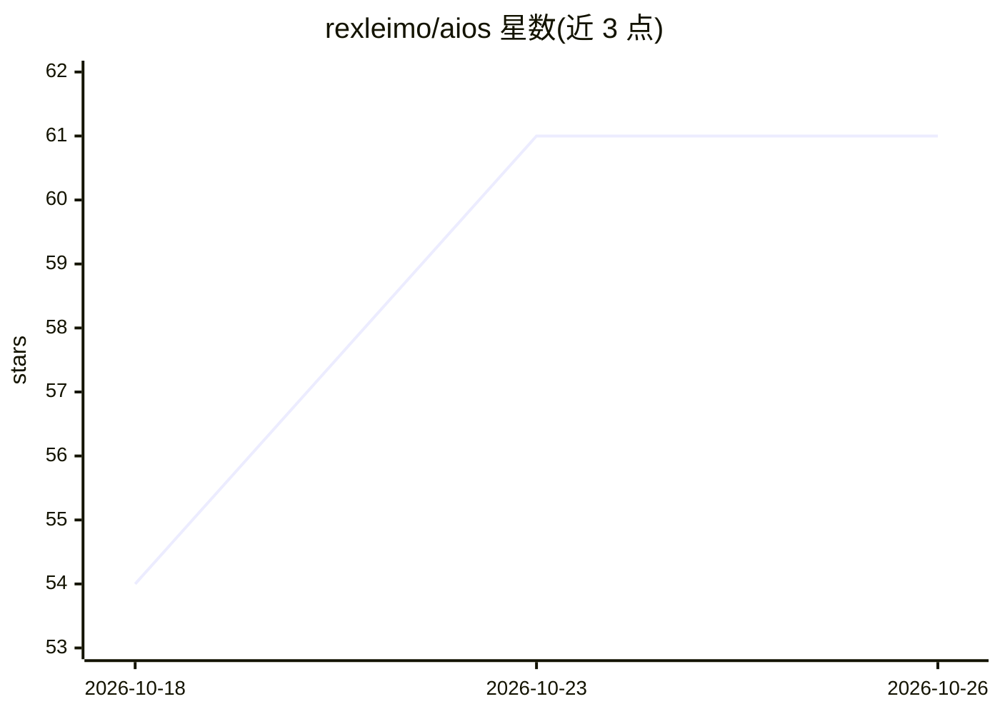

# rexleimo/aios

⭐ 61 · JavaScript · MIT · 推送 2026-10-23 · [GitHub](https://github.com/rexleimo/aios) · [官网](https://cli.rexai.top/) · 个人维护 · 中文 README

**本地优先的长期任务编码 agent 控制平面：记忆+编排+验证**

运行在既有 AI 编码客户端（Codex CLI、Claude Code、Gemini CLI、OpenCode、Hermes、Grok 等 10 种）之上的控制平面层，不替换 agent 本身：提供跨会话项目记忆 ContextDB（pull-based，本地存储，可用 aios memo search 检索）、工作流路由（默认 Rex）、多 agent 并行、可断点续跑的夜间任务，以及每次运行落盘的证据信封（命令、退出码、哈希）。全部本地运行。限制：需 Node.js 24 LTS、Git 与至少一个受支持客户端；各客户端功能深度不一，需用 aios doctor 核验。

## 筛选速览

| 维度 | 判定 | 备注 |
|---|---|---|
| AI 角色 | `ai-ecosystem` | LLM/agent 周边工具 |
| 许可风险 | `permissive` | MIT |
| 部署形态 | `None` |  |
| 模型依赖 | — | README 未给出锁定关系 |
| 硬件要求 | — | 无带数字的原话,不猜 |
| 安装摩擦 | `low` | 无编译、无系统依赖或容器化 |
| 成熟度 | — | 结构信号不足 |

## 能力要点

- ContextDB 跨会话项目记忆，pull-based 本地检索
- 支持 10 种编码客户端的原生或兼容集成
- 可断点续跑的夜间任务与多 agent 并行
- 每次运行产出证据信封（命令/退出码/哈希/测试输出）

## 适用场景

- 让编码 agent 记住上周的重构决策并延续工作
- 夜间无人值守跑完整任务，中断后可恢复
- 把 PR 审查与测试更新拆给并行 agent 并收集证据

## 场景标签

`编码 Agent` `Agent 记忆` `多智能体` · 领域:Agent 开发

## 证据(README 行号)

> L18: **It runs on top of the agent you already use** — Codex CLI, Claude Code, Gemini CLI, OpenCode, Hermes, Grok, WorkB
> L26: Your AI coding agent is smart — but it forgets everything between sessions, can't coordinate multi-step work on its
> L129: The project marker points clients at `.aios/context-db/index.json`. ContextDB is **pull-based**: agents search or 

## 星数曲线

2026-10-18 54 → 2026-10-26 61（+7）

---
*卡片 v1 · prompt 1.4 · 生成 2026-10-24 · 置信度 high · 依据 README sha `edb66c5fa6a1` · [字段定义](../../DATASET.md)*
