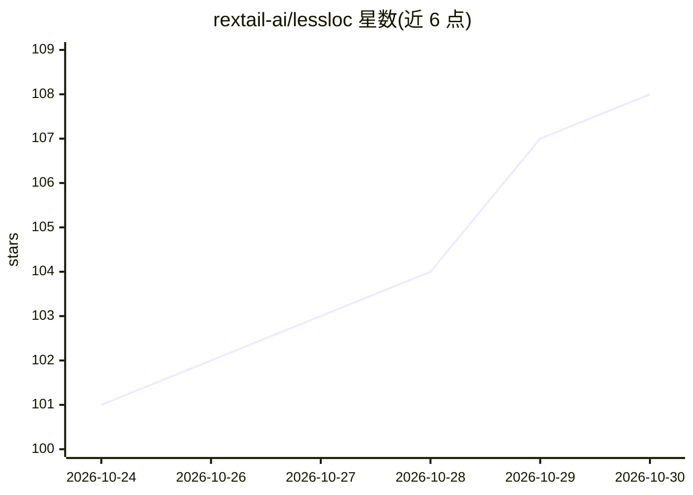

# rextail-ai/lessloc

⭐ 108 · JavaScript · Apache-2.0 · 推送 2026-10-26 · [GitHub](https://github.com/rextail-ai/lessloc) · [官网](https://lessloc.org) · 组织维护

**约束 AI 编码代理少写代码的钩子插件**

面向 Claude Code、Codex、OpenCode、GitHub Copilot、Gemini CLI、Cursor 等 AI 编码代理的插件：通过 hooks 约束代理复用项目已有代码、拒绝占位符/注释掉的代码/备份文件，并在代理声明完成而测试仍失败时要求其返回修复。README 给出 117 个真实变更的测量数据（23-36% 更少代码、15-26% 更低成本）。Apache-2.0 开源，无账号、无 API key、无网络调用、无依赖；通过让代理访问安装文档或 Claude Code 插件市场命令安装。

## 筛选速览

| 维度 | 判定 | 备注 |
|---|---|---|
| AI 角色 | `ai-ecosystem` | LLM/agent 周边工具 |
| 许可风险 | `permissive` | Apache-2.0 |
| 部署形态 | `None` |  |
| 模型依赖 | — | README 未给出锁定关系 |
| 硬件要求 | — | 无带数字的原话,不猜 |
| 安装摩擦 | `low` | 无编译、无系统依赖或容器化 |
| 成熟度 | — | 结构信号不足 |

## 能力要点

- 通过 hooks 约束多种 AI 编码代理的代码产出行为
- 拒绝占位符、注释掉的代码与备份文件
- 代理声明完成但测试失败时强制返回修复
- 无账号、无 API key、无网络调用、无依赖

## 适用场景

- 让我的 AI 编码代理复用项目已有代码、减少产出行数
- 降低 AI 编码任务的 token 开销
- 阻止代理提交占位符和垃圾文件
- 确保代理交付前测试真正通过

## 场景标签

 · 领域:开发工具/AI 编码代理

## 证据(README 行号)

> L7:  For Claude Code, Codex, OpenCode, GitHub Copilot, Gemini CLI, Cursor and many more.
> L42: - **Less code to review.** It reuses what your project already has.

## 星数曲线

2026-10-24 101 → 2026-10-30 108（+7）

---
*卡片 v1 · prompt 1.4 · 生成 2026-10-23 · 置信度 high · 依据 README sha `10f66f995f37` · [字段定义](../../DATASET.md)*
