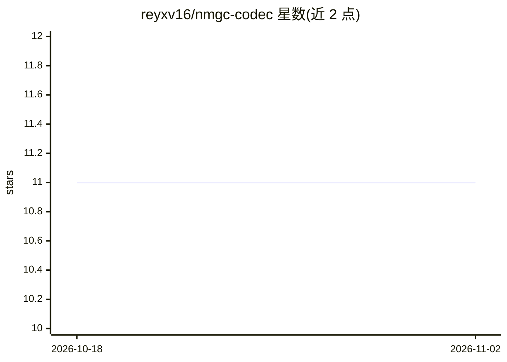

# reyxv16/nmgc-codec

⭐ 11 · Python · MIT · 推送 2026-08-27 · [GitHub](https://github.com/reyxv16/nmgc-codec) · 个人维护

**压缩神经网络权重的编解码器，用于内存受限推理**

NMGC（Nested Manhattan Grid Codec）提供三种压缩变体：有损的 NestedGridCodec（3-30x，按 bits 调节）、基于学习码本的 ResidualCodec/RVQ（约 5-8x）与比特精确的 LosslessCodec（1.07-2.25x）。权重以压缩形式存于 RAM 或磁盘，仅在加载或逐层计算时解压所需张量。核心机制为嵌套网格位切片、Zigzag delta + Huffman、分块归一化与逐层 RVQ。提供 Python 参考实现与 Rust 解码器（C ABI，约 150-270 MB/s），并带 llama.cpp 加载补丁，可在 llama.cpp 中直接运行 .nmgc 容器权重。限制：解压为 f16 计算仍需约 2 字节/参数的 RAM；实测 PPL 随位数下降单调升高（TinyLlama-1.1B 8bit 时 PPL 7.508→7.527）。

## 筛选速览

| 维度 | 判定 | 备注 |
|---|---|---|
| AI 角色 | `ai-ecosystem` | LLM/agent 周边工具 |
| 许可风险 | `permissive` | MIT |
| 部署形态 | `desktop` | 安装包/桌面程序 |
| 模型依赖 | local-ok | 支持本地模型 |
| 硬件要求 | — | 无带数字的原话,不猜 |
| 安装摩擦 | `medium` | 含编译或系统依赖之一 |
| 成熟度 | — | 结构信号不足 |

## 能力要点

- 三种编解码变体：有损嵌套网格（3-30x）、RVQ 残差（约 5-8x）、无损（1.07-2.25x）
- Rust 解码器带 C ABI，与 Python 参考实现比特一致，约 150-270 MB/s
- llama.cpp 加载补丁使 .nmgc 容器可直接作为权重源（LLAMA_NMGC_FILE）
- nmgc_get CLI 支持按名称从容器解压单个张量，支持逐层按需解压（AirLLM 式）

## 适用场景

- 在 13 GB 内存量级内加载 27B 级模型（4-bit 压缩，约 1% 质量损失）
- 将 safetensors/GGUF 模型打包为 .nmgc 容器以减小存储与内存占用
- 让 llama.cpp 从压缩容器直接解码权重运行推理
- 通过 AI agent 技能包在项目中应用 NMGC 压缩

## 场景标签

`模型量化` · 领域:训练与推理

## 证据(README 行号)

> L3: A codec for compressing neural network weights, designed for memory-constrained
> L4: inference: keep the whole model in RAM (or read it from disk) in compressed
> L5: form, and decompress only the tensors actually in use, at load time or per
> L21: - **llama.cpp integration**: a minimal loader patch lets llama.cpp run with

## 星数曲线

2026-10-18 11 → 2026-11-02 11（+0）

---
*卡片 v1 · prompt 1.4 · 生成 2026-11-01 · 置信度 high · 依据 README sha `116b4bc2ea33` · [字段定义](../../DATASET.md)*
