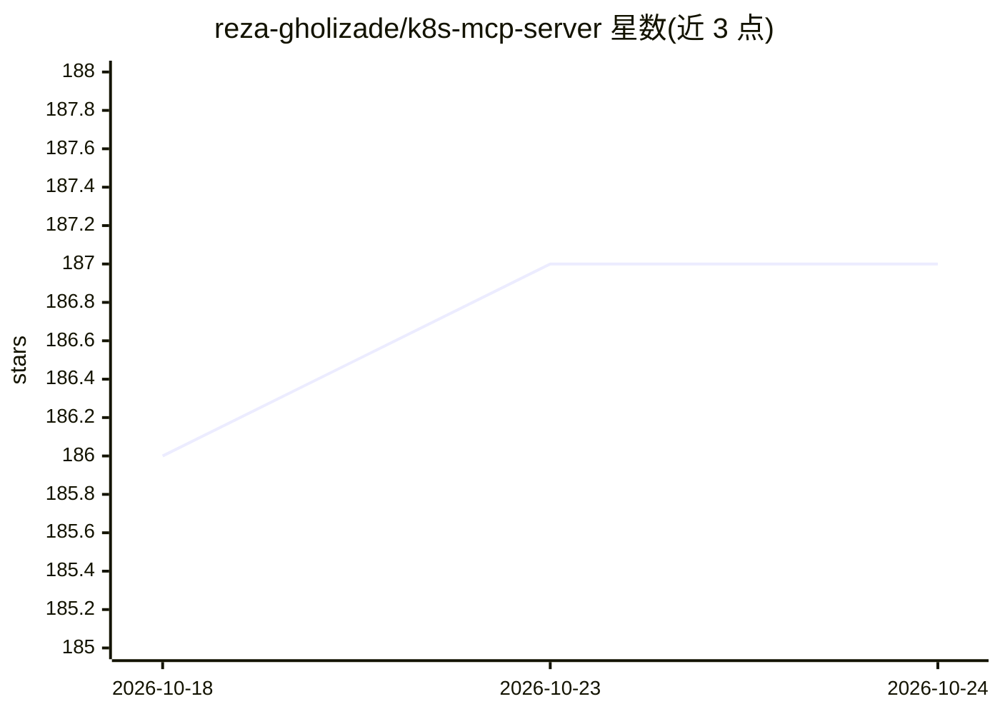

# reza-gholizade/k8s-mcp-server

⭐ 187 · Go · MIT · 推送 2026-10-21 · [GitHub](https://github.com/reza-gholizade/k8s-mcp-server) · 个人维护

**供 AI agent 管理 Kubernetes 集群的 MCP 服务器**

基于 Go 实现的 Model Context Protocol 服务器，将 Kubernetes 与 Helm 操作封装为标准化 MCP 工具：API 资源发现、资源列表/详情/描述（类似 kubectl describe）、Pod 日志、节点与 Pod 指标、事件、基于 YAML/JSON 清单的创建/更新/删除，以及 Helm 安装/升级/回滚等。面向希望通过 MCP 客户端（CLI 或 Web 应用）操作集群的开发者，支持 stdio/sse/streamable-http 三种传输模式。认证按优先级支持 kubeconfig 环境变量、API Server URL+token、集群内 ServiceAccount 与 kubeconfig 文件；提供 --read-only 与按类别禁用工具的安全开关，Docker 镜像以非 root 用户运行，HTTP 传输默认绑定回环地址并要求 bearer token。

## 筛选速览

| 维度 | 判定 | 备注 |
|---|---|---|
| AI 角色 | `ai-ecosystem` | LLM/agent 周边工具 |
| 许可风险 | `permissive` | MIT |
| 部署形态 | `desktop` | 安装包/桌面程序 |
| 模型依赖 | — | README 未给出锁定关系 |
| 硬件要求 | — | 无带数字的原话,不猜 |
| 安装摩擦 | `low` | 无编译、无系统依赖或容器化 |
| 成熟度 | — | 结构信号不足 |

## 能力要点

- kubectl describe 式资源描述、Pod 日志、节点/Pod 指标、事件查询等 MCP 工具
- Helm 安装/升级/回滚/仓库管理等工具集
- stdio/sse/streamable-http 三种传输模式，HTTP 默认回环+强制 token 认证
- --read-only 只读模式与 --no-k8s/--no-helm 工具类别开关

## 适用场景

- 让 MCP 客户端/AI 助手通过标准接口查询和操作 Kubernetes 集群
- 以只读模式让 agent 安全地巡检集群资源与指标
- 通过 Docker 或集群内 ServiceAccount 方式部署为团队共享的 MCP 服务

## 场景标签

 · 领域:云原生运维/AI Agent 基础设施

## 证据(README 行号)

> L3: A Kubernetes Model Context Protocol (MCP) server that provides tools for interacting with Kubernetes clusters throug
> L21: - **Standardized Interface**: Uses the MCP protocol for consistent tool interaction.

## 星数曲线

2026-10-18 186 → 2026-10-24 187（+1）

---
*卡片 v1 · prompt 1.4 · 生成 2026-10-22 · 置信度 high · 依据 README sha `fda8e9585c49` · [字段定义](../../DATASET.md)*
