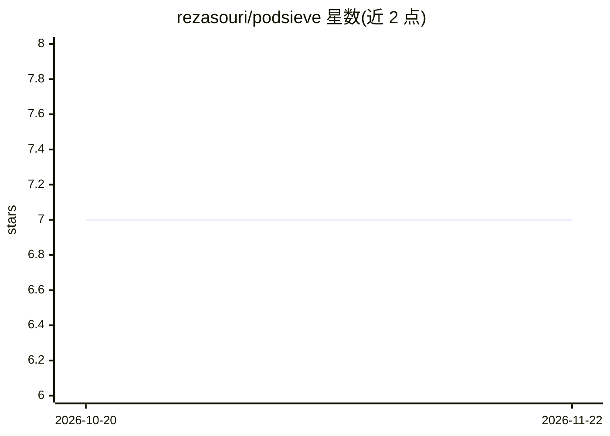

# rezasouri/podsieve

⭐ 7 · Python · MIT · 推送 2026-10-13 · [GitHub](https://github.com/rezasouri/podsieve) · 个人维护

**本地方言分轨桌面工具：说话人分离与人声分离生成数据集**

将音频导入、FFmpeg 转码、BS-RoFormer 人声分离与 pyannote 说话人分离整合为本地流水线，支持本地文件与 YouTube/Castbox URL 导入，可单独或按序执行各阶段，导出 RTTM、JSON 及按说话人分组的 WAV 片段。提供 PySide6/Qt Quick 桌面界面与 Python CLI 两种入口。运行需 Hugging Face token 访问 gated 模型；Windows GPU 路径尚未端到端验证，CPU-only 安装未经完整验证。

## 筛选速览

| 维度 | 判定 | 备注 |
|---|---|---|
| AI 角色 | `ai-native` | 本体是模型或模型工具 |
| 许可风险 | `permissive` | MIT |
| 部署形态 | `desktop` | 安装包/桌面程序 |
| 模型依赖 | — | README 未给出锁定关系 |
| 硬件要求 | — | 无带数字的原话,不猜 |
| 安装摩擦 | `medium` | 含编译或系统依赖之一 |
| 成熟度 | `idea` | |

## 能力要点

- FFmpeg 转码 + BS-RoFormer 人声分离 + pyannote 说话人分离的本地流水线
- Qt Quick/QML 桌面界面与 Python CLI 共享同一处理管线
- 质量分析：保留模型证据、排序可疑片段并导出复核片段
- 支持 MP3/WAV/FLAC/M4A/OGG 及 YouTube/Castbox URL 导入

## 适用场景

- 播客与访谈音频预处理成按说话人分组的训练片段
- 多人语音素材的组织与整理
- 搭建可复现的本地语音数据集制备流程
- 排查可疑说话人分段并导出复核音频

## 场景标签

`语音识别` · 领域:感知与多模态

## 证据(README 行号)

> L5: PodSieve combines **audio ingestion**, **FFmpeg conversion**, **BS-RoFormer vocal separation**, and **pyannote speak
> L61: - **Speaker diarization:** identify who spoke when using `pyannote.audio` and

## 星数曲线

2026-10-20 7 → 2026-11-22 7（+0）

---
*卡片 v1 · prompt 1.4 · 生成 2026-11-20 · 置信度 high · 依据 README sha `1f3f52e3ae6b` · [字段定义](../../DATASET.md)*
