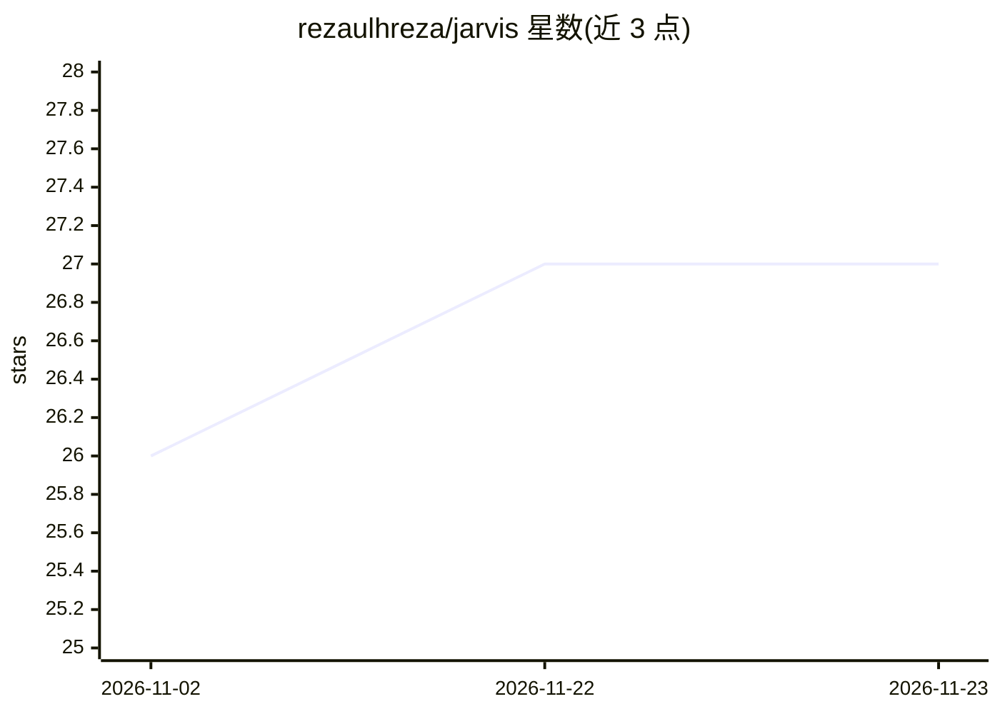

# rezaulhreza/jarvis

⭐ 27 · Python · 推送 2026-11-04 · [GitHub](https://github.com/rezaulhreza/jarvis) · 个人维护

**本地优先的个人 AI 助手，基于 Ollama 运行本地模型**

以 Python 包形式提供的个人 AI 助手，默认通过 Ollama 在本地运行，支持 CLI、Web UI、语音模式和 Telegram Bot 四种交互入口。内置 35+ 工具（网页搜索、文件操作、Git、天气等），通过 LLM 意图分类路由到对应处理器；提供 PDF/TXT/MD 文档 RAG 检索、SQLite 持久化记忆、事实抽取、多 Agent 并行编排与运行时动态技能创建。语音输入输出与多模态生成（图像/视频/音乐）依赖外部服务（Whisper、Chutes AI 等），多模态生成不经本地模型。

## 筛选速览

| 维度 | 判定 | 备注 |
|---|---|---|
| AI 角色 | `ai-native` | 本体是模型或模型工具 |
| 许可风险 | `none` | — |
| 部署形态 | `library` | 以包/库形式分发 |
| 模型依赖 | local-ok | 支持本地模型 |
| 硬件要求 | — | 无带数字的原话,不猜 |
| 安装摩擦 | `low` | 无编译、无系统依赖或容器化 |
| 成熟度 | — | 结构信号不足 |

## 能力要点

- 35+ 内置工具与 LLM 意图分类路由（17 种意图类型，启发式回退）
- 本地 RAG：支持 PDF/TXT/MD 文档、cross-encoder 重排序、ChromaDB 历史检索
- 持久化记忆系统：SQLite 存储、自动事实抽取、上下文压缩
- 四种入口：CLI / Web UI / 语音模式 / Telegram Bot（20+ 命令）

## 适用场景

- 在本地通过对话完成网页搜索、文件管理、Git 操作等日常任务
- 喂入自己的 PDF/Markdown 文档建立可检索的知识库
- 通过 Telegram 远程使用助手的搜索、记忆、工具调用功能
- 接入语音进行免手操作的分身式对话交互

## 场景标签

`AI 助手` `RAG` · 领域:对话与助手

## 证据(README 行号)

> L3:  A local-first personal AI assistant powered by Ollama.
> L10: - **Intent Classification**: LLM-based smart routing with heuristic fallback - automatically detects what you need
> L14: - **Knowledge Base (RAG)**: Feed your own documents (PDF, TXT, MD) with cross-encoder reranking for accurate retrie

## 星数曲线

2026-11-02 26 → 2026-11-23 27（+1）

---
*卡片 v1 · prompt 1.4 · 生成 2026-11-18 · 置信度 mid · 依据 README sha `1ffa289ca531` · [字段定义](../../DATASET.md)*
