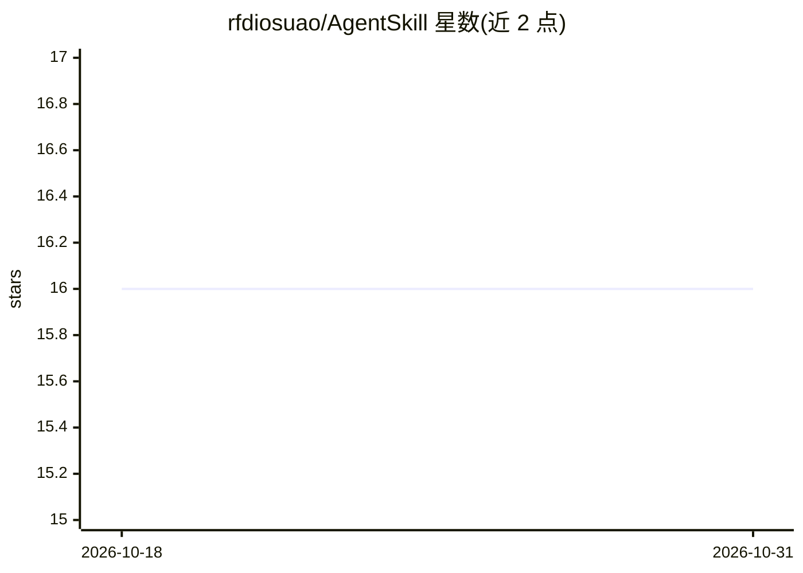

# rfdiosuao/AgentSkill

⭐ 16 · JavaScript · MIT · 推送 2026-10-25 · [GitHub](https://github.com/rfdiosuao/AgentSkill) · [官网](https://clawhub.ai/rfdiosuao) · 个人维护 · 中文 README

**面向 OpenClaw/Codex 的中文 Agent Skill 仓库与分发目录**

一个面向 OpenClaw、Codex 和通用 AI Agent 工作流的中文 Skill 仓库：收录来自真实任务的技能模块（README 审计、飞书多 Agent 配置、网络诊断、SVG 技术图解等），每个 Skill 以 SKILL.md 与源码/脚本/测试形式提供，并说明权限、风险与停止条件。支持从源码目录安装（openclaw skills install 或复制到 Codex Skills 目录）、从 ClawHub 按发布者前缀安装，另提供历史发布包 tar.gz 归档供离线审查。采用 MIT 许可证。

## 筛选速览

| 维度 | 判定 | 备注 |
|---|---|---|
| AI 角色 | `ai-knowledge` | 知识聚合/清单类 |
| 许可风险 | `permissive` | MIT |
| 部署形态 | `None` |  |
| 模型依赖 | — | README 未给出锁定关系 |
| 硬件要求 | — | 无带数字的原话,不猜 |
| 安装摩擦 | `low` | 无编译、无系统依赖或容器化 |
| 成熟度 | — | 结构信号不足 |

## 能力要点

- 技能来自真实任务，带边界说明、参考资料、脚本或测试
- 支持源码安装、ClawHub 带前缀安装与 tar.gz 离线归档三种分发途径
- craft-repository-readme 提供 audit/build/publish 三种工作模式与校验脚本

## 适用场景

- 为 OpenClaw 或 Codex agent 安装可复用技能模块
- 审计并重建 GitHub 仓库 README
- 回溯下载历史发布包做离线审查

## 场景标签

`精选清单` · 领域:学习与行业

## 证据(README 行号)

> L26: AgentSkill 是一个面向 OpenClaw、Codex 和通用 AI Agent 工作流的中文 Skill 仓库。这里不收集空泛提示词，每个 Skill 都应来自真实任务，并尽量带上边界说明、参考资料、脚本或测试。
> L28: > 仓库的增长路径：解决真实问题，跑通一次，把过程固化为 Skill，再通过验证、PR 和 ClawHub 继续分发。

## 星数曲线

2026-10-18 16 → 2026-10-31 16（+0）

---
*卡片 v1 · prompt 1.4 · 生成 2026-10-30 · 置信度 high · 依据 README sha `a7a13b500079` · [字段定义](../../DATASET.md)*
