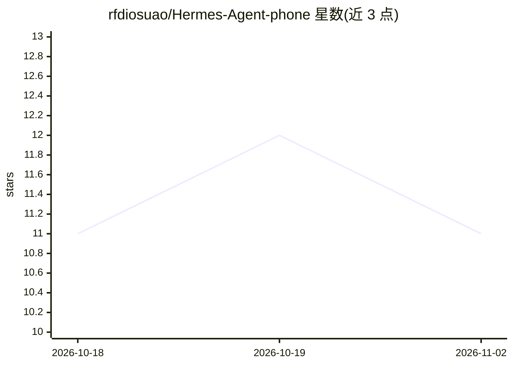

# rfdiosuao/Hermes-Agent-phone

⭐ 11 · Kotlin · Apache-2.0 · 推送 2026-07-22 · [GitHub](https://github.com/rfdiosuao/Hermes-Agent-phone) · 组织维护 · 中文 README

**通过 HTTP API 让 AI Agent 控制 Android 设备的自动化应用**

Android APK 形式的自动化服务：内置 LLM Agent，接收自然语言任务后自动规划并执行点击、滑动、输入等设备操作（基于无障碍服务），并通过 REST API（Token 认证）暴露给外部调用方。成功流程自动保存为模板，下次相似任务免 LLM 规划直接执行。提供 Agent API、Workflow 模板 API 与底层 Tool API 三层接口，附 Hermes Agent Skill，README 列出 Claude Code/Cursor/Coze/Dify 等已验证兼容工具。需 Android 9+，LAN API 不应暴露公网。

## 筛选速览

| 维度 | 判定 | 备注 |
|---|---|---|
| AI 角色 | `ai-ecosystem` | LLM/agent 周边工具 |
| 许可风险 | `permissive` | Apache-2.0 |
| 部署形态 | `None` |  |
| 模型依赖 | — | README 未给出锁定关系 |
| 硬件要求 | — | 无带数字的原话,不猜 |
| 安装摩擦 | `medium` | 含编译或系统依赖之一 |
| 成熟度 | — | 结构信号不足 |

## 能力要点

- 自然语言任务由 Agent 规划执行，支持截图与 UI 树解析
- 流程固化系统：成功流程存为模板，重复任务免 Token 直接执行
- 三层 HTTP API：Agent / Workflow 模板 / 底层坐标工具
- 提供 Hermes Agent Skill，兼容任何能发 HTTP 请求的 AI 工具

## 适用场景

- 让 Hermes Agent 等外部 AI 工具远程操控我的 Android 手机
- 把'打开微信发消息'这类重复流程固化为模板自动执行
- 在 Coze/Dify/n8n 工作流中通过 HTTP 节点控制手机

## 场景标签

`GUI 自动化` `工作流自动化` · 领域:效率与自动化

## 证据(README 行号)

> L40: |🔌 **HTTP API**|RESTful 接口，支持远程调用和第三方集成|
> L41: |🤝 **Hermes 集成**|与 Hermes Agent CLI 无缝配合，AI 控制手机|

## 星数曲线

2026-10-18 11 → 2026-11-02 11（+0）

---
*卡片 v1 · prompt 1.4 · 生成 2026-11-01 · 置信度 high · 依据 README sha `5c8f20bcde7a` · [字段定义](../../DATASET.md)*
