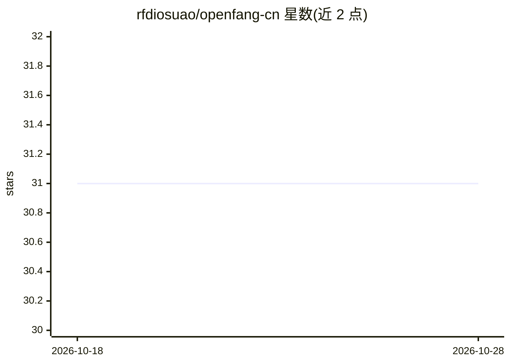

# rfdiosuao/openfang-cn

⭐ 31 · Rust · Apache-2.0 · 推送 2026-07-22 · [GitHub](https://github.com/rfdiosuao/openfang-cn) · 个人维护 · 中文 README

**开源 Agent OS OpenFang 的中文本地化社区维护版**

由社区维护的 OpenFang（RightNow-AI/openfang）中文本地化仓库：不改变上游核心架构，翻译 500+ 条用户可见文本，覆盖概览、聊天、Agents、Skills、Workflows、Wizard 等控制台页面与常用操作路径。仓库保留后端、前端、SDK、示例与部署资料，从源码用 cargo 构建后通过 openfang init/start 启动，访问本地 4200 端口的 Web 控制台。核心功能问题需参考上游仓库，中文版通过 Issue 接收漏译与术语反馈。

## 筛选速览

| 维度 | 判定 | 备注 |
|---|---|---|
| AI 角色 | `ai-ecosystem` | LLM/agent 周边工具 |
| 许可风险 | `permissive` | Apache-2.0 |
| 部署形态 | `desktop` | 安装包/桌面程序 |
| 模型依赖 | — | README 未给出锁定关系 |
| 硬件要求 | — | 无带数字的原话,不猜 |
| 安装摩擦 | `medium` | 含编译或系统依赖之一 |
| 成熟度 | — | 结构信号不足 |

## 能力要点

- 500+ 条用户可见文本的中文本地化，不改代码标识符
- 保留上游后端、前端、SDK、示例与部署资料
- cargo 源码构建，init/start 启动后提供 4200 端口控制台
- 沿用上游 MIT / Apache 2.0 双许可证

## 适用场景

- 中文用户安装并使用 OpenFang Agent OS
- 向社区报告漏译、术语问题与版本差异
- 在中文界面下管理 Agents、Skills、Workflows

## 场景标签

`Agent 框架` · 领域:Agent 开发

## 证据(README 行号)

> L19: OpenFang 是一个开源智能体操作系统。本仓库在保留核心能力的基础上，持续维护中文界面、中文表达和本地化体验，让中文用户更容易安装、理解和使用 OpenFang。
> L22: > 这是由社区维护的中文本地化仓库，并非 OpenFang 官方中文发行版。核心架构、功能演进与安全公告请同时参考上游项目 RightNow-AI/openfang。

## 星数曲线

2026-10-18 31 → 2026-10-28 31（+0）

---
*卡片 v1 · prompt 1.4 · 生成 2026-10-26 · 置信度 high · 依据 README sha `1a2123cc259d` · [字段定义](../../DATASET.md)*
