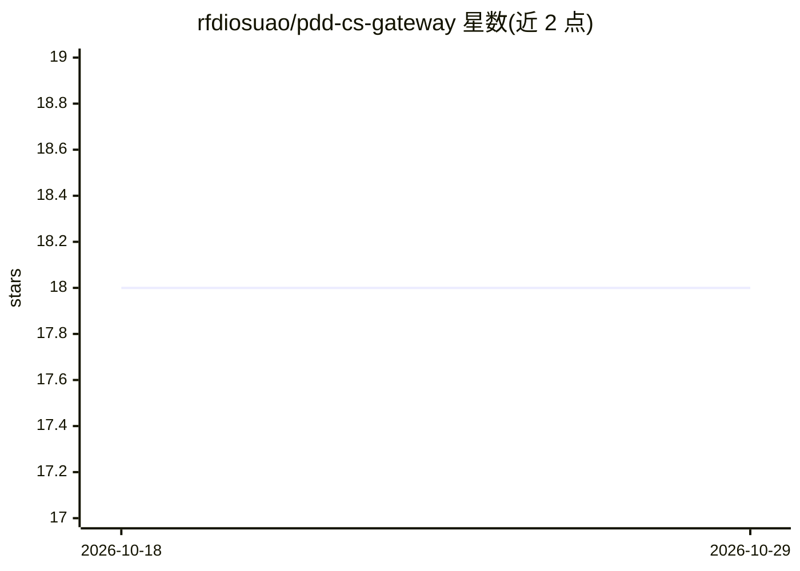

# rfdiosuao/pdd-cs-gateway

⭐ 18 · Python · MIT · 推送 2026-07-22 · [GitHub](https://github.com/rfdiosuao/pdd-cs-gateway) · 个人维护 · 中文 README

**拼多多客服消息网关：自动回复、人工接管与飞书通知**

面向拼多多商家的客服消息处理网关：通过 Webhook 接收平台推送的客服消息，做意图分类（订单/物流/商品咨询/售后/投诉），按规则或 AI 生成自动回复；支持关键词触发人工接管并发飞书通知。AI 回复依赖外部部署的 OpenClaw Fleet 协调中心（多实例处理），无 AI 时规则回复与人工接管仍可用。基于 FastAPI 提供 pip 安装、uvicorn 运行与 docker-compose 部署，README 提示需申请拼多多开放平台相应 API 权限。

## 筛选速览

| 维度 | 判定 | 备注 |
|---|---|---|
| AI 角色 | `ai-enhanced` | 去掉 AI 部分产品仍成立 |
| 许可风险 | `permissive` | MIT |
| 部署形态 | `self-host` | docker 或自建部署 |
| 模型依赖 | — | README 未给出锁定关系 |
| 硬件要求 | — | 无带数字的原话,不猜 |
| 安装摩擦 | `low` | 无编译、无系统依赖或容器化 |
| 成熟度 | — | 结构信号不足 |

## 能力要点

- Webhook 接收拼多多客服消息并做 5 类意图分类
- 规则 + AI 双通道自动回复，关键词触发人工接管
- OpenClaw Fleet 集成做多实例 AI 处理，飞书消息通知
- FastAPI 实现，提供健康检查与 /docs API 文档

## 适用场景

- 拼多多商家自动应答订单、物流、售后等客服消息
- 人工接管时通过飞书及时通知客服介入
- 结合 OpenClaw Fleet 用 AI 生成客服回复

## 场景标签

`聊天机器人` `工作流自动化` · 领域:效率与自动化

## 证据(README 行号)

> L3:  拼多多客服消息处理网关：自动回复、人工接管、飞书通知与 OpenClaw AI 集成
> L19: - ✅ 自动回复（规则 + AI）
> L21: - ✅ OpenClaw Fleet 集成（多实例 AI 处理）

## 星数曲线

2026-10-18 18 → 2026-10-29 18（+0）

---
*卡片 v1 · prompt 1.4 · 生成 2026-10-29 · 置信度 mid · 依据 README sha `e5a1d3554c3c` · [字段定义](../../DATASET.md)*
