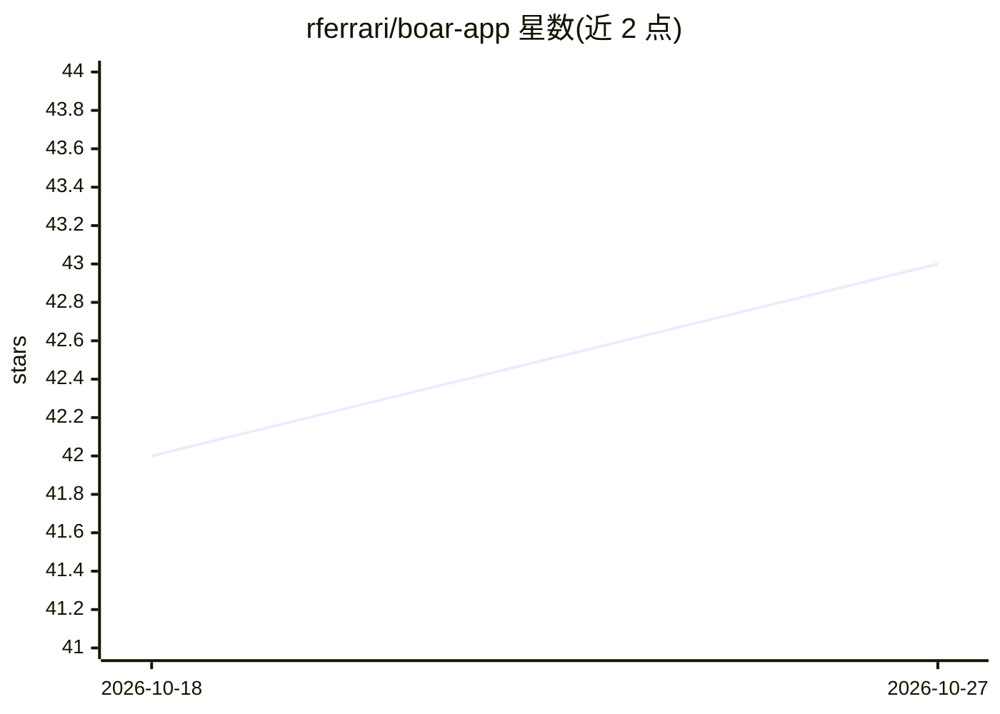

# rferrari/boar-app

⭐ 43 · C · MIT · 推送 2026-10-25 · [GitHub](https://github.com/rferrari/boar-app) · [官网](https://boarapp.com) · 个人维护

**离线运行的 Android 本地 AI 研究问答助手，答案带出处**

原生 Android 应用（Kotlin/Jetpack Compose），通过 JNI 调用 llama.cpp 在手机端本地推理：首次设置下载答案模型（Qwen3 4B/1.7B 按内存分档）、BGE Small 检索模型与 Wikipedia Vital Articles 知识包，之后飞行模式下可回答问题，答案引用本地来源（内置维基条目、知识包、用户文档），点击引用可读原文。无账号、无服务器、不依赖 Google Play Services。另提供约 2 GB 的全离线 APK 与实验性 Boar Labs 插件体系（含 stable-diffusion.cpp 图像生成）。当前为 2.0.0-rc1 预发布版本。

## 筛选速览

| 维度 | 判定 | 备注 |
|---|---|---|
| AI 角色 | `ai-native` | 本体是模型或模型工具 |
| 许可风险 | `permissive` | MIT |
| 部署形态 | `desktop` | 安装包/桌面程序 |
| 模型依赖 | local-ok | 支持本地模型 |
| 硬件要求 | — | 无带数字的原话,不猜 |
| 安装摩擦 | `high` | 编译与系统依赖俱全 |
| 成熟度 | `idea` | |

## 能力要点

- llama.cpp 经 JNI 本地推理，答案模型按内存选 Qwen3 4B 或 1.7B
- 答案引用本地来源（维基/知识包/用户文档），可点开原文
- 提供无网络需求的全离线 APK（含模型，约 2 GB）
- Boar Labs 实验插件体系，含图像生成等实验室

## 适用场景

- 无网络环境下在手机上查询知识并获得带出处的回答
- 把自有文档作为本地知识来源进行问答
- 注重隐私、不依赖账号与云服务的本地 AI 使用

## 场景标签

`文档问答` · 领域:知识与检索

## 证据(README 行号)

> L12:  An open-source research assistant that runs on your phone and shows where every answer came from.
> L27: llama.cpp, called through JNI. What we

## 星数曲线

2026-10-18 42 → 2026-10-27 43（+1）

---
*卡片 v1 · prompt 1.4 · 生成 2026-10-25 · 置信度 high · 依据 README sha `c15a0a19f8ef` · [字段定义](../../DATASET.md)*
