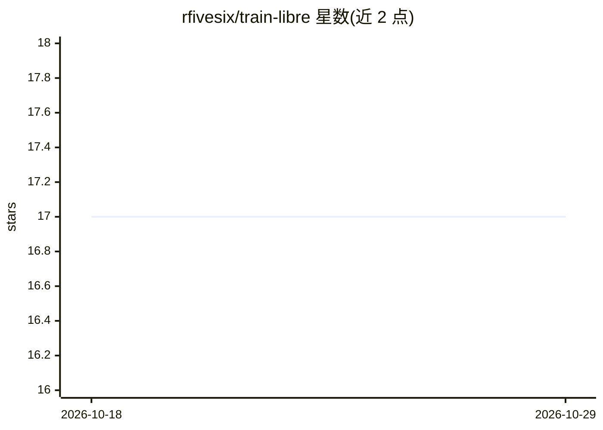

# rfivesix/train-libre

⭐ 17 · Dart · GPL-3.0 · 推送 2026-10-27 · [GitHub](https://github.com/rfivesix/train-libre) · [官网](https://trainlibre.com/) · 个人维护

**面向健身者的离线优先训练与营养追踪 App（Android/iOS）**

Flutter 构建的开源健身 App，提供训练记录（PPL/上下分化等模板、渐进超负荷组数记录）、400+ 离线动作库、卡路里/宏量营养追踪（贝叶斯 TDEE 估算）、身体围度测量、恢复与就绪度模型、可穿戴同步（Apple Health/Health Connect）。AI 为可选功能：拍照/语音/文本记录餐食，支持 iOS 端 Apple Foundation Models 离线识别及 BYOK 接入多家云厂商或本地 Ollama，配 SQLite 校验管线。全部数据本地存储，无广告无强制账号，GPL-3.0 许可。

## 筛选速览

| 维度 | 判定 | 备注 |
|---|---|---|
| AI 角色 | `ai-enhanced` | 去掉 AI 部分产品仍成立 |
| 许可风险 | `viral` | GPL-3.0 |
| 部署形态 | `None` |  |
| 模型依赖 | local-ok | 支持本地模型 |
| 硬件要求 | — | 无带数字的原话,不猜 |
| 安装摩擦 | `low` | 无编译、无系统依赖或容器化 |
| 成熟度 | — | 结构信号不足 |

## 能力要点

- 离线优先架构，数据全部本地存储，无广告/强制账号/商业追踪
- AI 餐食识别：iOS 26+ 端上 Foundation Models 离线运行，或 BYOK 云端/本地端点
- 400+ 离线动作库（源自 OpenExerciseDB/wger）与模板化训练记录
- PR 检测、Brzycki 1RM 估算、肌肉恢复就绪度热图等算法功能

## 适用场景

- 记录力量训练组数、个人纪录与训练量趋势
- 追踪卡路里与宏量营养，获得自适应每周营养建议
- 拍照识别餐食并记录到本地日记
- 同步可穿戴设备的步数、睡眠与心率数据

## 场景标签

 · 领域:健康与健身

## 证据(README 行号)

> L28: Train Libre is an open-source, offline-first strength training and fitness app for logging workouts, routines, calo
> L97: - **On-Device AI Meal Capture (Apple Intelligence & Foundation Models):** Zero-cloud, 100% offline meal recognition
> L98: - **Privacy-First AI Meal Capture & Multi-Provider BYOK:** Capture meals from photos, dictated speech, or text. Sup

## 星数曲线

2026-10-18 17 → 2026-10-29 17（+0）

---
*卡片 v1 · prompt 1.4 · 生成 2026-10-29 · 置信度 high · 依据 README sha `0fd4fe6c0504` · [字段定义](../../DATASET.md)*
