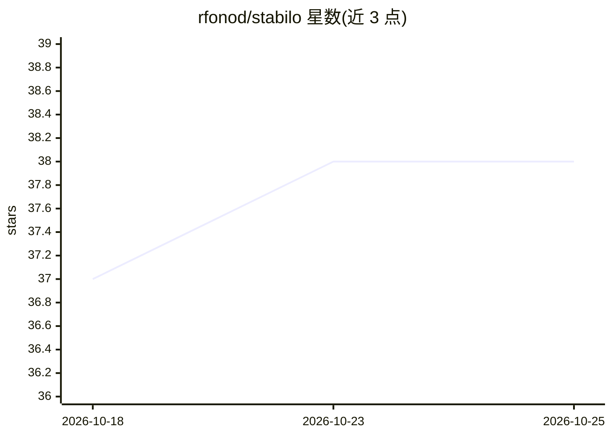

# rfonod/stabilo

⭐ 38 · Python · MIT · 推送 2026-10-24 · [GitHub](https://github.com/rfonod/stabilo) · [官网](https://rfonod.github.io/stabilo/) · 个人维护

**视频帧与目标轨迹相对参考帧稳定的 Python 库**

面向无人机等动态场景视频的配准稳定库：将每一帧和逐帧跟踪框对齐到选定参考帧，采用单应或仿射变换与鲁棒 RANSAC 估计，支持用掩膜排除车辆、行人等动态区域。特征匹配在同一 API 下提供 6 种经典检测器（ORB/SIFT 等）与 5 种学习型检测器（XFeat/DISK/LoFTR 等，经 kornia），可选用 LightGlue 匹配器、OpenCV CUDA（经典管线）或 PyTorch CUDA/MPS（学习型模型）加速。同时提供 Python 库（Stabilizer 类）与 CLI（stabilo video / stabilo tracks）。默认参数面向高空俯视无人机影像；学习型检测器存在旋转敏感与内存开销的限制。

## 筛选速览

| 维度 | 判定 | 备注 |
|---|---|---|
| AI 角色 | `ai-native` | 本体是模型或模型工具 |
| 许可风险 | `permissive` | MIT |
| 部署形态 | `library` | 以包/库形式分发 |
| 模型依赖 | — | README 未给出锁定关系 |
| 硬件要求 | `cpu-ok` | |
| 安装摩擦 | `medium` | 含编译或系统依赖之一 |
| 成熟度 | — | 结构信号不足 |

## 能力要点

- 每帧与跟踪框统一对齐到选定参考帧，而非相邻帧平滑
- 6 种经典 + 5 种学习型特征检测器与多种匹配器，单一标志切换
- 五种几何形态的排除掩膜抑制动态区域关键点
- 经典管线 OpenCV CUDA 加速、学习型模型 PyTorch cuda/mps 加速

## 适用场景

- 稳定无人机航拍视频并保持全程坐标可比
- 把逐帧检测/跟踪结果变换到参考坐标系下做轨迹分析
- 在含运动物体的画面中排除动态区域后做配准

## 场景标签

`图像视频处理` · 领域:感知与多模态

## 证据(README 行号)

> L15: - 🧠 **Classical and learned features in one API**: 6 classical detectors (ORB, SIFT, RootSIFT, BRISK, KAZE, AKAZE) 
> L76: Stabilo ships classical OpenCV detectors and learning-based detectors/matchers from kornia as core functionality. T

## 星数曲线

2026-10-18 37 → 2026-10-25 38（+1）

---
*卡片 v1 · prompt 1.4 · 生成 2026-10-25 · 置信度 high · 依据 README sha `dd732c3f67e2` · [字段定义](../../DATASET.md)*
