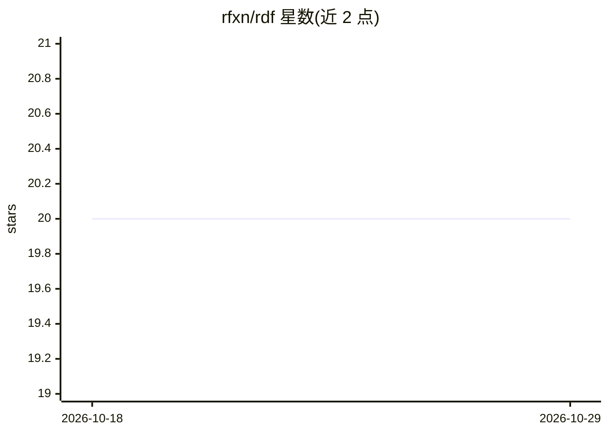

# rfxn/rdf

⭐ 20 · Shell · GPL-2.0 · 推送 2026-10-28 · [GitHub](https://github.com/rfxn/rdf) · [官网](https://rfxn.github.io/rdf/) · 组织维护

**给 AI 编程 agent 的项目规约治理层：约定、质量门与领域专家注入**

RDF 是面向 AI 编程 agent（Claude Code、Codex、Antigravity CLI、Gemini CLI legacy）的规约治理框架：在人与会话之间编码项目约定、质量门与领域专家知识，生成类型化 agent persona。`/r-init` 自动检测技术栈并搭建治理文件；七个通用 agent 的行为由项目治理文件而非提示词决定。提供 rdf doctor 健康检查、canonical→deployed 的生成/同步模型、多 Claude 账号切换（rdf account）、会话生命周期命令（/r-start、/r-save 等）与 token 用量报告（rdf tokens，含 Codex 报告）。以 Bash/Python 脚本与 Claude Code 插件方式安装；GPL v2 许可，社区驱动维护。

## 筛选速览

| 维度 | 判定 | 备注 |
|---|---|---|
| AI 角色 | `ai-ecosystem` | LLM/agent 周边工具 |
| 许可风险 | `viral` | GPL-2.0 |
| 部署形态 | `None` |  |
| 模型依赖 | — | README 未给出锁定关系 |
| 硬件要求 | — | 无带数字的原话,不猜 |
| 安装摩擦 | `low` | 无编译、无系统依赖或容器化 |
| 成熟度 | — | 结构信号不足 |

## 能力要点

- `/r-init` 自动检测项目类型并生成治理文件与质量门
- canonical 编辑→rdf generate→部署目录的生成/同步模型与漂移检测（.rdf-hash）
- 七个通用 agent，行为由每项目治理文件区分
- rdf tokens 从本地会话记录报告 token 用量与成本（含 --codex）

## 适用场景

- 让 AI 编程 agent 在项目中遵循团队编码约定与质量门
- 多 Claude Code 账号在同一组项目间切换使用
- 审计 agent 会话的 token 开销与上下文成本

## 场景标签

`Agent 框架` `提示工程` · 领域:Agent 开发

## 证据(README 行号)

> L11: RDF is a convention governance layer for AI coding agents. It sits between the human and the AI runtime (Claude Cod
> L23: Seven universal agents handle every project. Their behavior is shaped by governance files initialized per-project, 

## 星数曲线

2026-10-18 20 → 2026-10-29 20（+0）

---
*卡片 v1 · prompt 1.4 · 生成 2026-10-28 · 置信度 high · 依据 README sha `e840ffefe87d` · [字段定义](../../DATASET.md)*
