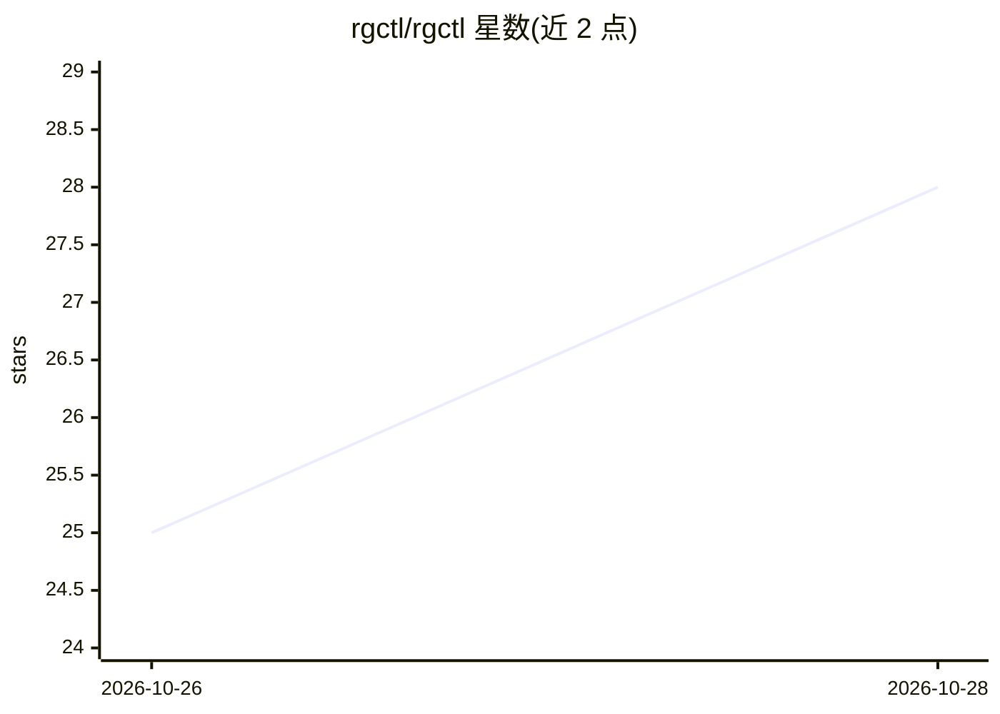

# rgctl/rgctl

⭐ 28 · Rust · MIT · 推送 2026-10-26 · [GitHub](https://github.com/rgctl/rgctl) · [官网](https://rgctl.io) · 组织维护

**给 LLM 编程 agent 用的代码知识图谱 CLI，输出紧凑确定性 JSON**

Rust 编写的命令行代码知识图谱工具：用 tree-sitter 对 15+ 种 Tier-1 语言建立 Hybrid CPG（30+ 类型关系、CFG/PDG、mmap 列式快照），索引一次后即可查询调用者、影响面（blast-radius）、控制/数据流切片、克隆、社区与 PR 调用路径差异，以 -f json 输出含错误信封的紧凑结果，供编程 agent 消费而非全文 grep。支持增量更新、多仓库合并、SCIP 覆盖、安全污点分析与 PR 评审技能包，可安装进 Cursor/Claude/Codex 等 agent。提供一键安装脚本、预编译二进制与 cargo 源码构建（Rust 1.85+）。

## 筛选速览

| 维度 | 判定 | 备注 |
|---|---|---|
| AI 角色 | `ai-ecosystem` | LLM/agent 周边工具 |
| 许可风险 | `permissive` | MIT |
| 部署形态 | `None` |  |
| 模型依赖 | — | README 未给出锁定关系 |
| 硬件要求 | — | 无带数字的原话,不猜 |
| 安装摩擦 | `medium` | 含编译或系统依赖之一 |
| 成熟度 | — | 结构信号不足 |

## 能力要点

- Hybrid CPG 代码知识图谱，30+ 类型关系，mmap 快照与增量更新
- callers/blast-radius/slice/clones 等分析命令输出紧凑 -f json 与结构化错误信封
- Tier-1 深度分析覆盖 15 种语言（C/C++/Java/Python/Rust/Go 等），100% 语法验证
- agent 技能包可安装进 Cursor/Claude/Codex 等 IDE 或 CLI agent

## 适用场景

- 让编程 agent 用少量 token 回答'谁调用了 X'、影响面与数据流切片问题
- 本地 PR/分支结构评审，生成 REVIEW_REPORT.md 与改动路径判定
- 跨语言大型仓库（如 Linux kernel）做索引与增量查询

## 场景标签

`知识图谱` `代码审查` · 领域:编码与开发

## 证据(README 行号)

> L1: # rgctl - Code knowledge graph for LLM agents.
> L32: > Index once (`discover`), then ask callers, blast radius, control/data-flow slices, clones, communities, and PR ca
> L112: ## Use with coding agents

## 星数曲线

2026-10-26 25 → 2026-10-28 28（+3）

---
*卡片 v1 · prompt 1.4 · 生成 2026-10-26 · 置信度 high · 依据 README sha `1595468acc78` · [字段定义](../../DATASET.md)*
