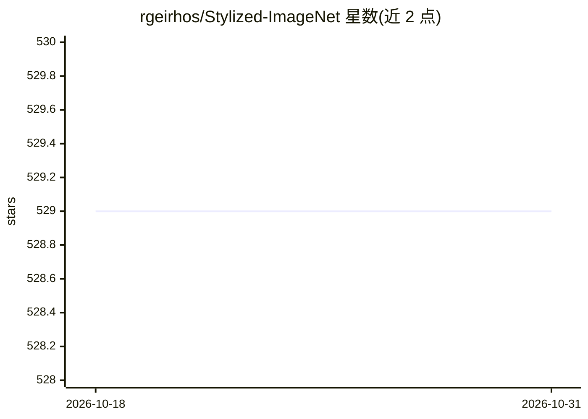

# rgeirhos/Stylized-ImageNet

⭐ 529 · Python · MIT · 推送 2026-07-21 · [GitHub](https://github.com/rgeirhos/Stylized-ImageNet) · [官网](https://openreview.net/forum?id=Bygh9j09KX) · 组织维护

**生成 Stylized-ImageNet 数据集的代码：诱导 CNN 形状偏置**

提供从 ImageNet 与 Kaggle 绘画数据集生成 Stylized-ImageNet 的完整流程代码：下载约 38G 绘画风格图，配置 ImageNet 路径后运行脚本（假定有 GPU），生成需约 134G 磁盘空间的数据集。风格迁移部分取自 pytorch-AdaIN 实现。数据集可替代 ImageNet 用于训练，用于诱导 CNN 的形状偏置以研究纹理偏置问题；论文材料与预训练 CNN 在独立仓库。提供 Docker 镜像，不直接提供数据集下载。

## 筛选速览

| 维度 | 判定 | 备注 |
|---|---|---|
| AI 角色 | `ai-knowledge` | 知识聚合/清单类 |
| 许可风险 | `permissive` | MIT |
| 部署形态 | `desktop` | 安装包/桌面程序 |
| 模型依赖 | — | README 未给出锁定关系 |
| 硬件要求 | — | 无带数字的原话,不猜 |
| 安装摩擦 | `low` | 无编译、无系统依赖或容器化 |
| 成熟度 | — | 结构信号不足 |

## 能力要点

- 从 ImageNet + 绘画数据集生成风格化数据集的完整代码（预处理与 AdaIN 风格迁移）
- 可作为训练中 ImageNet 的直接替代（drop-in replacement）
- 提供 Docker 镜像（bethgelab/deeplearning:cuda9.0-cudnn7）
- 另在独立仓库提供基于 Stylized-ImageNet 预训练的 CNN

## 适用场景

- 我要研究 CNN 的纹理偏置与形状偏置问题
- 我想用风格化数据训练或评测模型的泛化行为
- 我想复现 ICLR 2019 论文的数据集构建过程

## 场景标签

`图像视频处理` `模型训练` · 领域:感知与多模态

## 证据(README 行号)

> L6: This repository contains information and code on how to create Stylized-ImageNet, a stylized version of ImageNet tha
> L13: As you can see, local textures are heavily distorted, while global object shapes remain (more or less) intact durin

## 星数曲线

2026-10-18 529 → 2026-10-31 529（+0）

---
*卡片 v1 · prompt 1.4 · 生成 2026-10-21 · 置信度 high · 依据 README sha `074a4f5c0938` · [字段定义](../../DATASET.md)*
