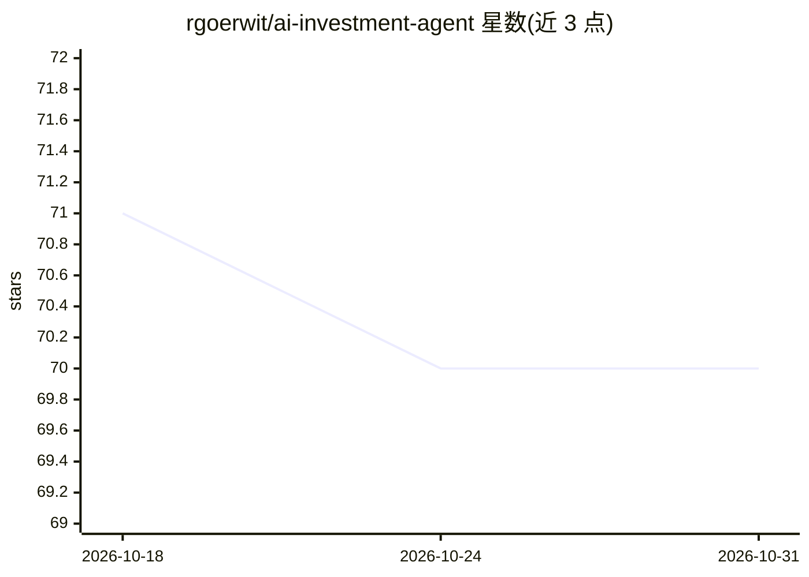

# rgoerwit/ai-investment-agent

⭐ 70 · Python · MIT · 推送 2026-10-12 · [GitHub](https://github.com/rgoerwit/ai-investment-agent) · [官网](https://medium.com/p/172783ed6961) · 个人维护

**面向美股以外小中盘价值股的多 agent 股票研究系统**

基于 LangGraph 的多 agent 股票研究系统，针对美国以外关注度较低的小中盘价值股，支持单只股票分析、全市场筛选流水线，并可通过 CLI 或本地 Flask 仪表盘运行，可选与 Interactive Brokers 组合对账。系统由约 20 个分工 agent（基本面、新闻、情绪、法律、多空辩论、法务审计、组合经理等）组成，LLM 通过六组座位绑定到 Google/OpenAI/Anthropic/DeepSeek 等供应商，评审与区域分析要求供应商独立性。运行需 Python 3.12、Poetry 及多个 API key（Finnhub、Tavily 必需）。

## 筛选速览

| 维度 | 判定 | 备注 |
|---|---|---|
| AI 角色 | `ai-native` | 本体是模型或模型工具 |
| 许可风险 | `permissive` | MIT |
| 部署形态 | `self-host` | docker 或自建部署 |
| 模型依赖 | locked-api |  |
| 硬件要求 | — | 无带数字的原话,不猜 |
| 安装摩擦 | `low` | 无编译、无系统依赖或容器化 |
| 成熟度 | — | 结构信号不足 |

## 能力要点

- 约 20 个分工 agent 角色覆盖基本面、法律、多空辩论与组合决策
- LLM 按六组座位绑定多家供应商，review/regional 座位要求供应商独立
- 确定性证据、评分与决策规则约束模型结论，缺失证据保持不确定
- 支持单 ticker 分析、全市场筛选与可选 IBKR 组合对账

## 适用场景

- 我想让多 agent 系统研究美股以外的低关注度小中盘价值股
- 我想跑全市场筛选流水线发现候选标的
- 我想把已有研究结果与我的 Interactive Brokers 持仓对账

## 场景标签

`多智能体` `金融量化` · 领域:Agent 开发

## 证据(README 行号)

> L3: This repository is a multi-agent equity research system that targets under-followed small- and mid-cap value stocks 
> L21: - Multi-agent international equity analysis for individual tickers
> L63: |Bull / Bear Researchers|Opposing investment cases, both on the base provider, with balanced one- or two-round deba

## 星数曲线

2026-10-18 71 → 2026-10-31 70（-1）

---
*卡片 v1 · prompt 1.4 · 生成 2026-10-24 · 置信度 mid · 依据 README sha `a3daa64320cd` · [字段定义](../../DATASET.md)*
