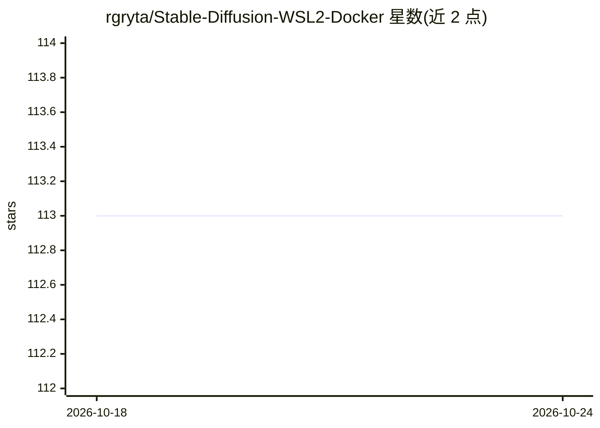

# rgryta/Stable-Diffusion-WSL2-Docker

⭐ 113 · PowerShell · MIT · 推送 2025-12-20 · [GitHub](https://github.com/rgryta/Stable-Diffusion-WSL2-Docker) · 个人维护

**Windows 上一键安装 Stable Diffusion 的 WSL2+Docker 脚本**

面向 Windows 用户的 Stable Diffusion 部署工具：通过 PowerShell 脚本（install.bat）自动完成 WSL2、Docker、CUDA 相关依赖与 AUTOMATIC1111 webui 容器的安装，start.bat 启动后经 http://localhost:7860 访问。提供自动安装与手动分步安装两条路径，手动路径需自行配置 WSL、Docker 与 nvidia-docker2。限制：当前配置仅支持 Nvidia GPU（CUDA 12，GTX 900 系列或更高），需要管理员权限，默认安装约 25GB。

## 筛选速览

| 维度 | 判定 | 备注 |
|---|---|---|
| AI 角色 | `ai-ecosystem` | LLM/agent 周边工具 |
| 许可风险 | `permissive` | MIT |
| 部署形态 | `self-host` | docker 或自建部署 |
| 模型依赖 | — | README 未给出锁定关系 |
| 硬件要求 | — | 无带数字的原话,不猜 |
| 安装摩擦 | `low` | 无编译、无系统依赖或容器化 |
| 成熟度 | — | 结构信号不足 |

## 能力要点

- install.bat 一键安装，start.bat/stop.bat 启动停止
- 自动安装全部依赖（含 xformers）
- 依赖 AUTOMATIC1111 webui 与 StabilityAI Stable-Diffusion 当前版本
- 提供手动分步安装与开发（docker-compose.override）流程

## 适用场景

- 在 Windows 上快速部署 Stable Diffusion webui
- 避免手工配置 WSL2、Docker 与 GPU 环境
- 用容器方式运行 Stable Diffusion 并通过浏览器访问

## 场景标签

`图像生成` · 领域:内容生成

## 证据(README 行号)

> L5: This repository is meant to allow for easy installation of Stable Diffusion on Windows. One click to install. Second
> L9: In it's current configuration only Nvidia GPUs are supported. This script will also install all dependencies (includ

## 星数曲线

2026-10-18 113 → 2026-10-24 113（+0）

---
*卡片 v1 · prompt 1.4 · 生成 2026-10-23 · 置信度 high · 依据 README sha `5cab88a68ec7` · [字段定义](../../DATASET.md)*
