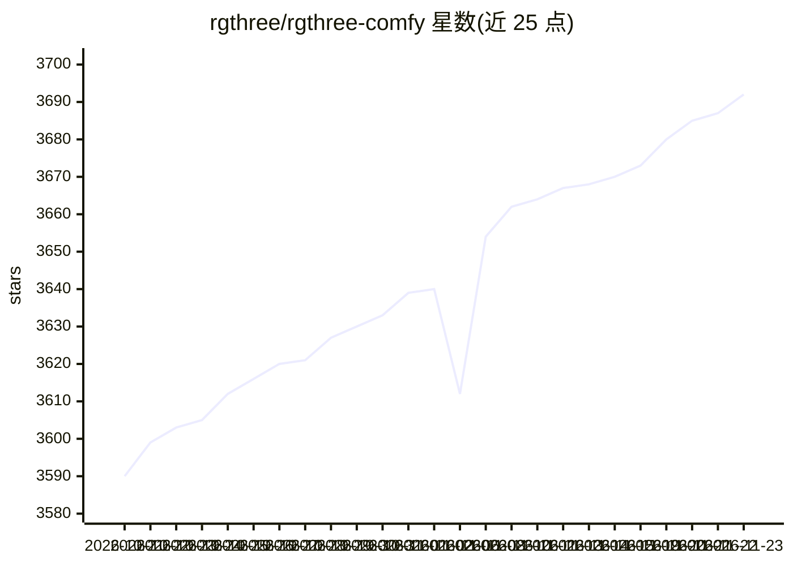

# rgthree/rgthree-comfy

⭐ 3,692 · JavaScript · MIT · 推送 2026-10-30 · [GitHub](https://github.com/rgthree/rgthree-comfy) · 个人维护

**为 ComfyUI 提供节点扩展与工作流改进的工具集**

一个 ComfyUI 自定义节点集合：提供 Seed 控制、Reroute、书签导航、Context 数据传递、图像对比、LoRA 批量加载（Power Lora Loader）、增强提示词节点（含 SDXL 变体）、分支切换（Context Switch/Any Switch）、分组批量静音（Fast Groups Muter）及多行代码求值节点（Power Puter）等。通过 git clone 安装到 ComfyUI 的 custom_nodes 目录后随 ComfyUI 启动加载。部分功能可在设置中按需关闭，设置存储于 rgthree_config.json。作者声明该集合基于自身使用场景开发。

## 筛选速览

| 维度 | 判定 | 备注 |
|---|---|---|
| AI 角色 | `ai-ecosystem` | LLM/agent 周边工具 |
| 许可风险 | `permissive` | MIT |
| 部署形态 | `None` |  |
| 模型依赖 | — | README 未给出锁定关系 |
| 硬件要求 | — | 无带数字的原话,不猜 |
| 安装摩擦 | `low` | 无编译、无系统依赖或容器化 |
| 成熟度 | — | 结构信号不足 |

## 能力要点

- Power Lora Loader 支持一次加载多个 LoRA 并逐项开关
- Power Puter 节点支持多行代码求值输出 INT/FLOAT/STRING/BOOLEAN
- Fast Groups Muter 自动收集工作流分组并批量静音/取消静音
- Seed 节点支持随机、固定及自增/自减等快捷操作

## 适用场景

- 整理和优化 ComfyUI 工作流的连线与布局
- 在工作流中批量加载与切换多个 LoRA
- 对比查看生成图像的差异
- 用分组静音快速切换工作流分支

## 场景标签

`图像生成` · 领域:内容生成

## 证据(README 行号)

> L9: A collection of nodes and improvements created while messing around with ComfyUI. I made them for myself to make my 
> L17: 1. Install the great ComfyUi.
> L33: # ✴️ The Nodes

## 星数曲线

2026-10-21 3,590 → 2026-11-23 3,692（+102）

---
*卡片 v1 · prompt 1.4 · 生成 2026-11-23 · 置信度 high · 依据 README sha `76b381e911a8` · [字段定义](../../DATASET.md)*
