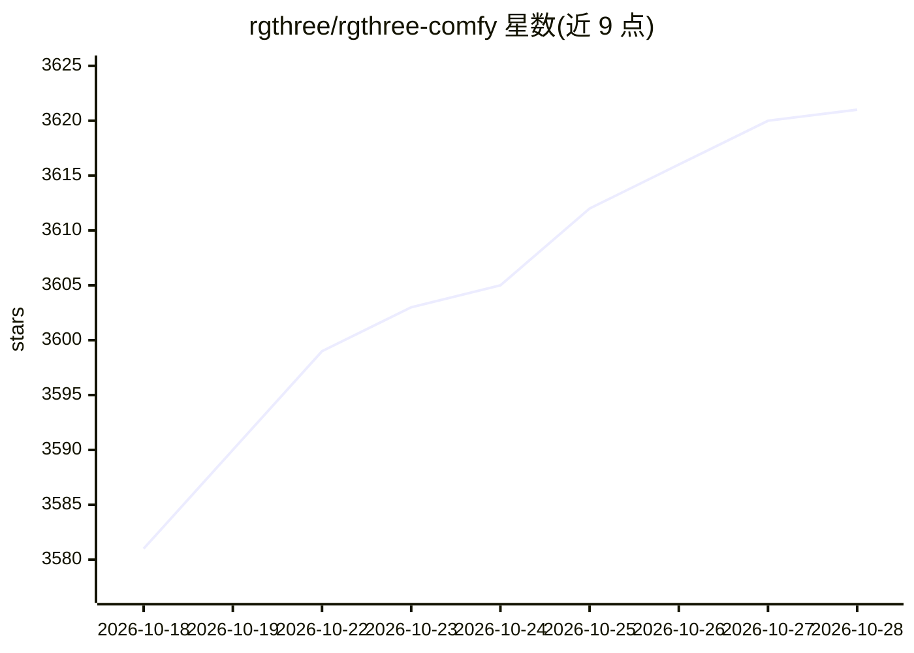

# rgthree/rgthree-comfy

⭐ 3,627 · JavaScript · MIT · 推送 2026-10-28 · [GitHub](https://github.com/rgthree/rgthree-comfy) · 个人维护

**ComfyUI 自定义节点集：种子控制、Reroute、Context 等工作流整理工具**

作者为个人 Stable Diffusion 工作流开发的 ComfyUI 节点合集，通过 git clone 到 custom_nodes 目录安装。节点包括：Seed 种子控制（随机/固定/增量）、多方向 Reroute 布线、Context/Context Big 通用属性传递与合并、Power Prompt（嵌入/LoRA 下拉与 <lora:...> 标签解析，含 SDXL 版）、Context Switch 分支选择、Fast Muter/Bypasser 快速开关面板、Mute/Bypass Relay 与 Repeater、Node Collector 连线整理等。README 附带关于 Muting 与图执行方向（从输出节点反向执行）的技术说明。作者声明节点为个人使用而做，未在自身场景之外充分测试。

## 筛选速览

| 维度 | 判定 | 备注 |
|---|---|---|
| AI 角色 | `ai-ecosystem` | LLM/agent 周边工具 |
| 许可风险 | `permissive` | MIT |
| 部署形态 | `None` |  |
| 模型依赖 | — | README 未给出锁定关系 |
| 硬件要求 | — | 无带数字的原话,不猜 |
| 安装摩擦 | `low` | 无编译、无系统依赖或容器化 |
| 成熟度 | — | 结构信号不足 |

## 能力要点

- Context/Context Big 节点合并与拆分通用流程属性
- Fast Muter/Bypasser 面板式快速启停连接节点
- Power Prompt 支持 embeddings/loras 下拉与 <lora:...> 标签自动解析（含 SDXL 版）
- 提供工作流断链检测与修复页面（links.html）

## 适用场景

- 整理 ComfyUI 工作流的连线和节点布局
- 通过 Context Switch 与 Muting 实现多路径分支并避免多余计算
- 用面板快速开关节点、组合多分支生成-放大-保存流程

## 场景标签

`图像生成` · 领域:内容生成

## 证据(README 行号)

> L3: A collection of nodes I've created while messing around with Stable Diffusion. I made them for myself to make my wor
> L9: 1. Install the great ComfyUi.
> L13:     git clone https://github.com/rgthree/rgthree-comfy.git

## 星数曲线

2026-10-18 3,581 → 2026-10-28 3,621（+40）

---
*卡片 v1 · prompt 1.4 · 生成 2026-10-20 · 置信度 high · 依据 README sha `5080c2ba20ec` · [字段定义](../../DATASET.md)*
