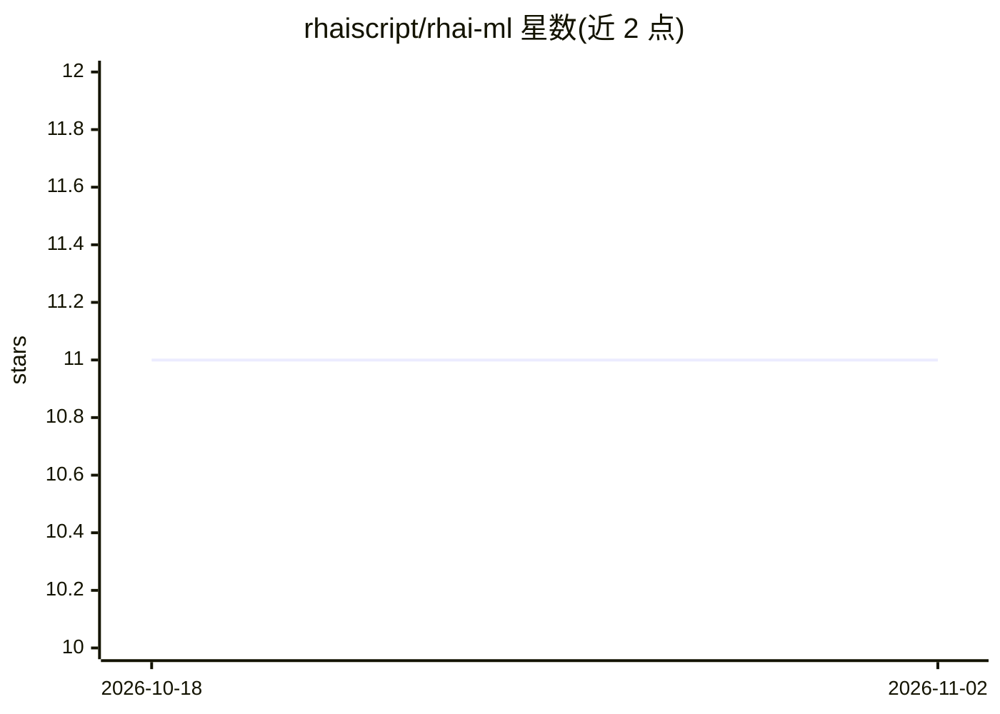

# rhaiscript/rhai-ml

⭐ 11 · Rust · Apache-2.0 · 推送 2026-09-19 · [GitHub](https://github.com/rhaiscript/rhai-ml) · [官网](https://crates.io/crates/rhai-ml) · 个人维护

**在 Rhai 脚本中训练回归模型的 Rust 库**

基于 SmartCore 后端为 Rhai 脚本语言提供机器学习能力的 Rust crate：可在脚本内直接训练线性回归、Lasso 回归与逻辑回归模型，支持可选正则化设置，并可注册到已有 Rhai Engine 作为全局模块使用。输入须为非空矩形有限数值数组，逻辑回归使用整数类标签，非法输入返回可由脚本 try/catch 处理的 Rhai 错误。附带可选 metadata feature 用于生成 API 文档与测试示例，版本 0.1.4。

## 筛选速览

| 维度 | 判定 | 备注 |
|---|---|---|
| AI 角色 | `ai-native` | 本体是模型或模型工具 |
| 许可风险 | `permissive` | Apache-2.0 |
| 部署形态 | `library` | 以包/库形式分发 |
| 模型依赖 | — | README 未给出锁定关系 |
| 硬件要求 | — | 无带数字的原话,不猜 |
| 安装摩擦 | `low` | 无编译、无系统依赖或容器化 |
| 成熟度 | — | 结构信号不足 |

## 能力要点

- 在 Rhai 脚本内训练线性/Lasso/逻辑回归模型，支持可选正则化
- 可注册到已有 Rhai Engine 作为全局模块
- 非法输入返回可被脚本 try/catch 捕获的 Rhai 错误
- 可选 metadata feature 生成 API 文档并测试示例

## 适用场景

- 在 Rust 应用嵌入的 Rhai 脚本中做小型回归/分类训练与预测
- 为已有 Rhai 引擎添加机器学习函数包
- 用脚本快速验证线性、Lasso、逻辑回归三种算法

## 场景标签

 · 领域:机器学习库/脚本语言扩展

## 证据(README 行号)

> L7: Machine learning for the Rhai scripting language, backed by
> L8: SmartCore. Train linear, lasso, and logistic regression

## 星数曲线

2026-10-18 11 → 2026-11-02 11（+0）

---
*卡片 v1 · prompt 1.4 · 生成 2026-11-01 · 置信度 high · 依据 README sha `f4b01feb4013` · [字段定义](../../DATASET.md)*
