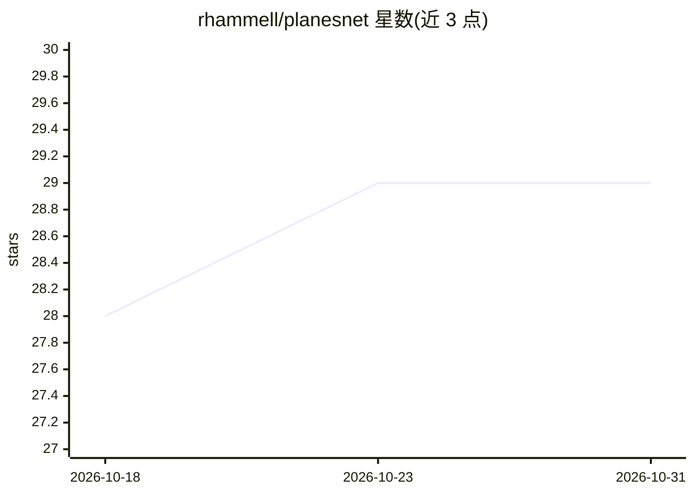

# rhammell/planesnet

⭐ 29 · 推送 2026-01-15 · [GitHub](https://github.com/rhammell/planesnet) · 个人维护

**飞机检测训练数据集：3.2 万张 Planet 卫星影像标注切片**

从 Planet 卫星影像（PlanetScope 视觉场景，3 米分辨率正射校正）提取的带标注图像切片数据集，共 32000 张 20x20 RGB 图像，分为 plane（8000 张）与 no-plane（24000 张，含地物采样、部分机身、易混淆亮目标三类各三分之一）两类，用于训练飞机位置检测的机器学习算法。提供 .7z 压缩 PNG 目录与 Python 可加载的 pickle 文件（data/labels/scene_ids/locations 四个元素），文件名编码标签、场景 ID 与经纬度。影像源自 Planet Open California 数据，按 CC-BY-SA 许可发布。

## 筛选速览

| 维度 | 判定 | 备注 |
|---|---|---|
| AI 角色 | `ai-knowledge` | 知识聚合/清单类 |
| 许可风险 | `none` | — |
| 部署形态 | `None` |  |
| 模型依赖 | — | README 未给出锁定关系 |
| 硬件要求 | — | 无带数字的原话,不猜 |
| 安装摩擦 | `low` | 无编译、无系统依赖或容器化 |
| 成熟度 | — | 结构信号不足 |

## 能力要点

- 32000 张 20x20 RGB 切片，plane/no-plane 二分类标注
- no-plane 类含混淆样本：曾被机器学习模型误判的亮目标切片
- 提供 pickle 格式，加载为含 data/labels/scene_ids/locations 的 Python 字典
- 文件名编码标签、PlanetScope 场景 ID 与中心点经纬度

## 适用场景

- 训练卫星影像中的飞机检测模型
- 研究遥感目标检测中的易混淆样本问题
- 通过场景 ID 结合 Planet API 下载原始影像

## 场景标签

`目标检测` · 领域:感知与多模态

## 证据(README 行号)

> L2: PlanesNet is a labeled dataset consiting of image chips extracted from Planet satellite imagery. The purpose of Plan
> L4: The dataset includes 32000 20x20 RGB images labeled with either a "plane" or "no-plane" classification. Image chips 

## 星数曲线

2026-10-18 28 → 2026-10-31 29（+1）

---
*卡片 v1 · prompt 1.4 · 生成 2026-10-26 · 置信度 high · 依据 README sha `e644d0e38927` · [字段定义](../../DATASET.md)*
