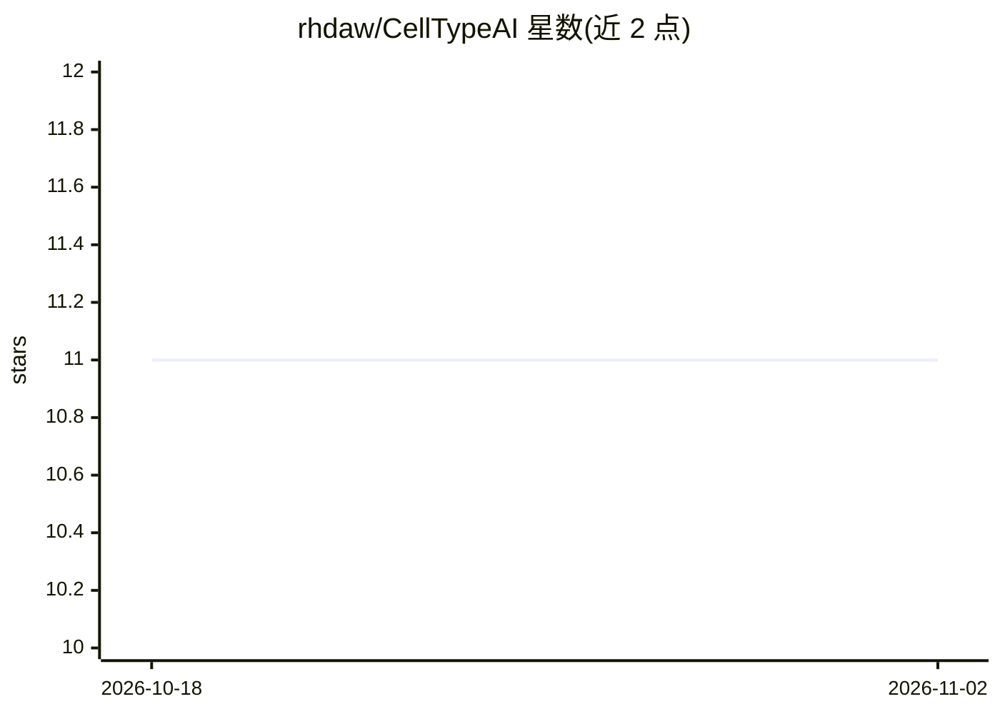

# rhdaw/CellTypeAI

⭐ 11 · Jupyter Notebook · GPL-2.0 · 推送 2026-03-03 · [GitHub](https://github.com/rhdaw/CellTypeAI) · 个人维护

**用本地 LLM 自动注释 scRNA-seq 细胞类型的 Python 工具**

面向单细胞 RNA 测序分析者的自动细胞类型注释程序：读取经 Leiden/Louvain 聚类的 AnnData 对象，提取各簇差异表达基因，通过 Ollama 本地运行的 LLM（默认 phi4:14b，可选 qwen3 系列）结合 RAG 与可选集成策略（多次提示取众数）生成注释，结果写入 adata.obs['cell_type_ai']。需指定物种与 16 种组织类型之一，运行前需安装并启动 Ollama 服务。以 pip 包形式提供，集成于 scanpy 分析流程。

## 筛选速览

| 维度 | 判定 | 备注 |
|---|---|---|
| AI 角色 | `ai-native` | 本体是模型或模型工具 |
| 许可风险 | `viral` | GPL-2.0 |
| 部署形态 | `library` | 以包/库形式分发 |
| 模型依赖 | local-ok | 支持本地模型 |
| 硬件要求 | — | 无带数字的原话,不猜 |
| 安装摩擦 | `low` | 无编译、无系统依赖或容器化 |
| 成熟度 | — | 结构信号不足 |

## 能力要点

- 从聚类结果提取 DEGs 并交由本地 LLM 注释细胞类型
- 集成策略：n 次提示取众数注释
- 支持 phi4:14b / qwen3:32b / qwen3:235b 等 Ollama 模型
- 注释结果直接写入 AnnData 的 .obs 列

## 适用场景

- 我对 scRNA-seq 数据做完聚类后自动给各簇标注细胞类型
- 在本地环境完成注释，数据不出本机
- 把细胞注释嵌入现有 scanpy 分析流程

## 场景标签

`数据分析` · 领域:效率与自动化

## 证据(README 行号)

> L3: CellTypeAI, a streamlined, scalable program developed to perform context-dependent cell identification in scRNA-seq 
> L49: Takes a processed `.h5ad` object, extracts Differentially Expressed Genes (DEGs) from each cluster, and utilizes a 

## 星数曲线

2026-10-18 11 → 2026-11-02 11（+0）

---
*卡片 v1 · prompt 1.4 · 生成 2026-11-01 · 置信度 high · 依据 README sha `1e205c9b2a88` · [字段定义](../../DATASET.md)*
