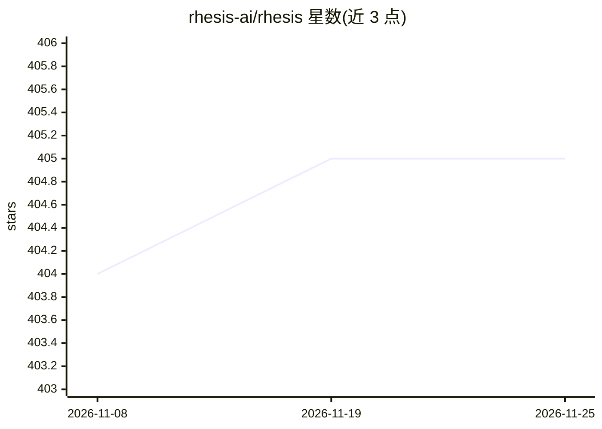

# rhesis-ai/rhesis

⭐ 405 · Python · NOASSERTION · 推送 2026-11-23 · [GitHub](https://github.com/rhesis-ai/rhesis) · [官网](https://www.rhesis.ai/) · 组织维护

**AI agent 团队协作评测层：测试、模拟、追踪与专家标注**

面向构建 AI agent 团队的开源协作平台：通过 SDK 连接器或 REST 端点接入待测 agent，领域专家在浏览器 playground 中与 agent 对话并留下结构化的通过/失败判定与评论；反馈沉淀为测试集与指标并在 CI 中运行。提供从 PRD/需求生成测试、多轮对话模拟（Penelope）、对抗性测试（Polyphemus、garak）、基于 OpenTelemetry 的生产追踪及实验对比。支持 SaaS 或 Docker/K8s 自托管，本地模式明示不用于生产。

## 筛选速览

| 维度 | 判定 | 备注 |
|---|---|---|
| AI 角色 | `ai-ecosystem` | LLM/agent 周边工具 |
| 许可风险 | `none` | NOASSERTION |
| 部署形态 | `self-host` | docker 或自建部署 |
| 模型依赖 | — | README 未给出锁定关系 |
| 硬件要求 | — | 无带数字的原话,不猜 |
| 安装摩擦 | `low` | 无编译、无系统依赖或容器化 |
| 成熟度 | — | 结构信号不足 |

## 能力要点

- 领域专家通过 UI 对 agent 回答做 pass/fail 判定，反馈沉淀为 CI 测试
- SDK 连接器走出站 WebSocket，agent 无需公网 URL
- OpenTelemetry 追踪（延迟/tokens/成本），自动埋点支持 LangChain、LangGraph、Google ADK 等
- 提供 Cloud、Docker、Kubernetes(Helm)、GCP(Terraform) 多种部署方式

## 适用场景

- 让法务、客服主管等领域专家直接评审 agent 回答并转化为测试
- 在每次变更后自动运行同一套测试与指标
- 对比模型、提示词或检索改动在同一测试集上的质量与成本

## 场景标签

`模型评测` `LLM 可观测性` · 领域:评测与运维

## 证据(README 行号)

> L35:  The open-source collaboration layer for teams building AI agents.
> L65: **1. Connect the agent you are building.** Via the SDK or a REST endpoint, no public URL needed
> L98: - **Conversation simulation** with Penelope; **adversarial probing** with Polyphemus and garak

## 星数曲线

2026-11-08 404 → 2026-11-25 405（+1）

---
*卡片 v1 · prompt 1.4 · 生成 2026-11-17 · 置信度 mid · 依据 README sha `b5a82e196c30` · [字段定义](../../DATASET.md)*
